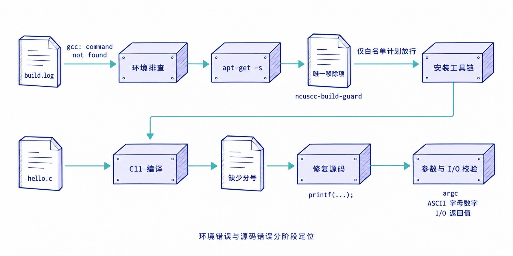
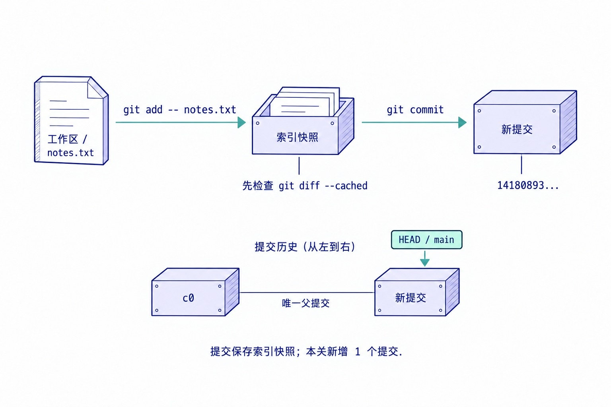
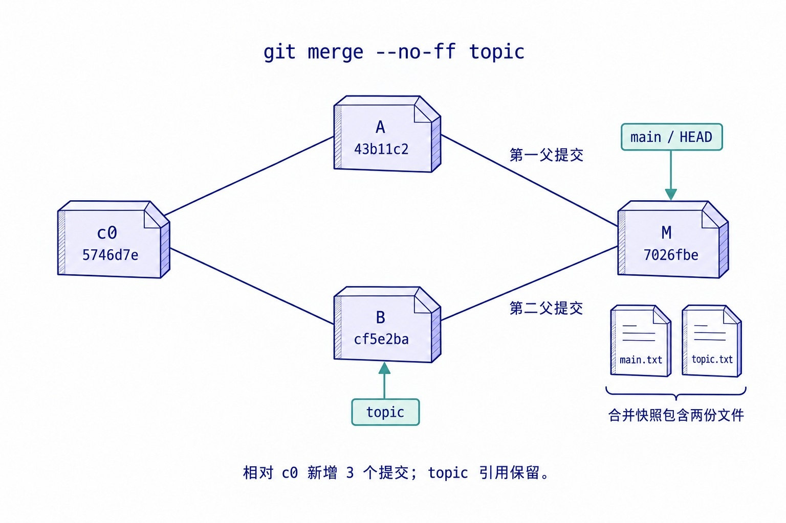
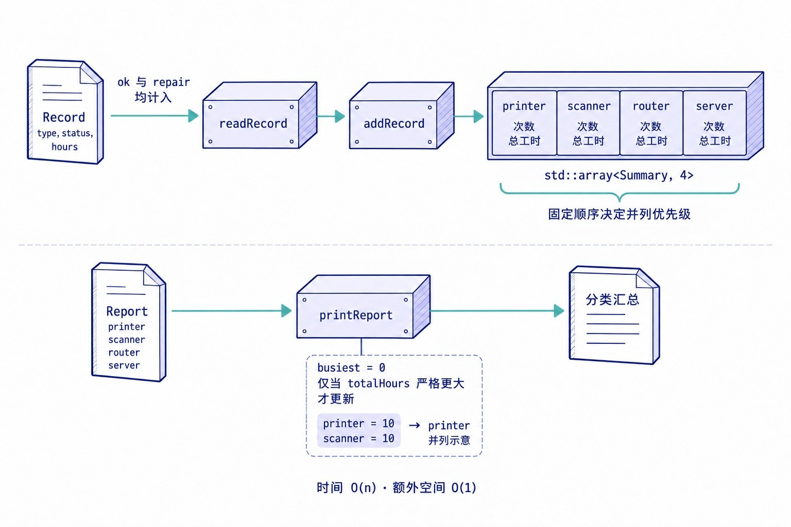
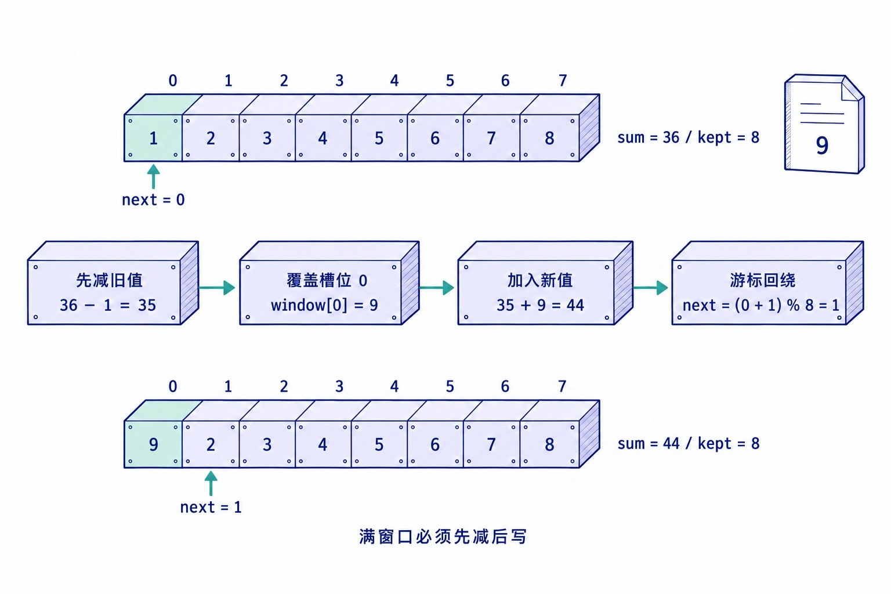
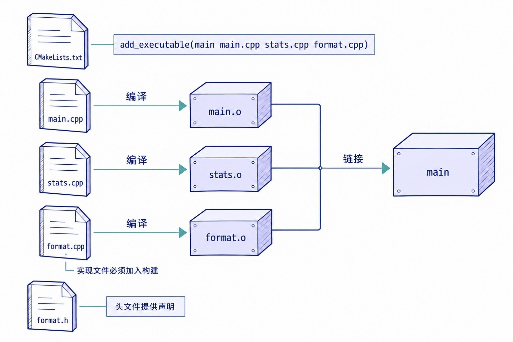
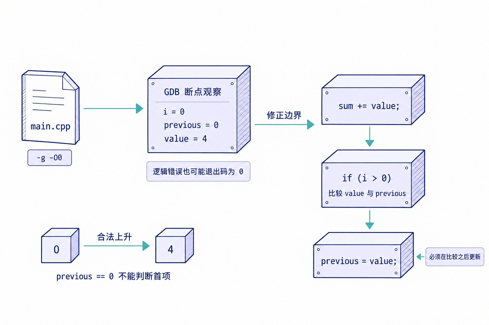
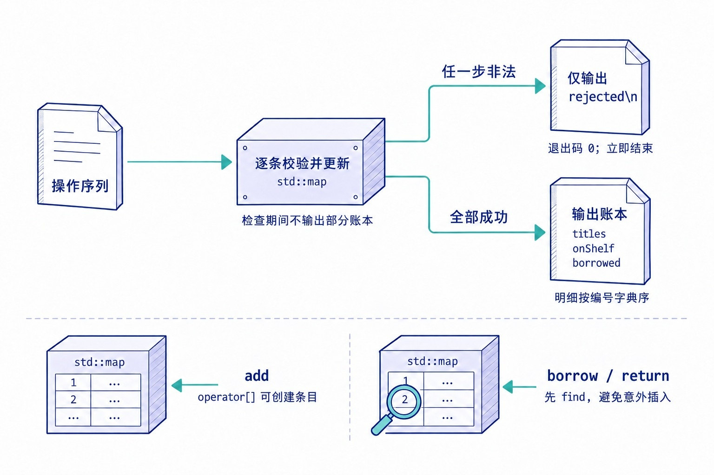
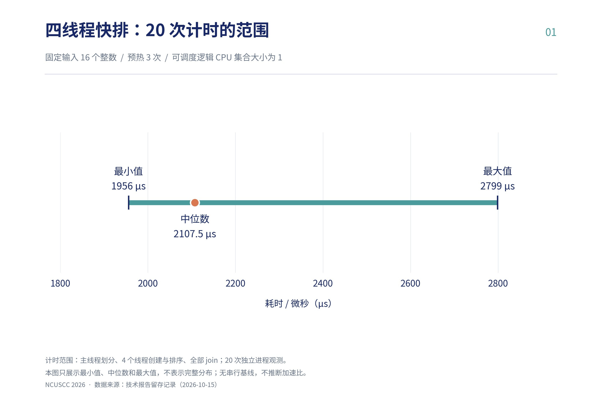
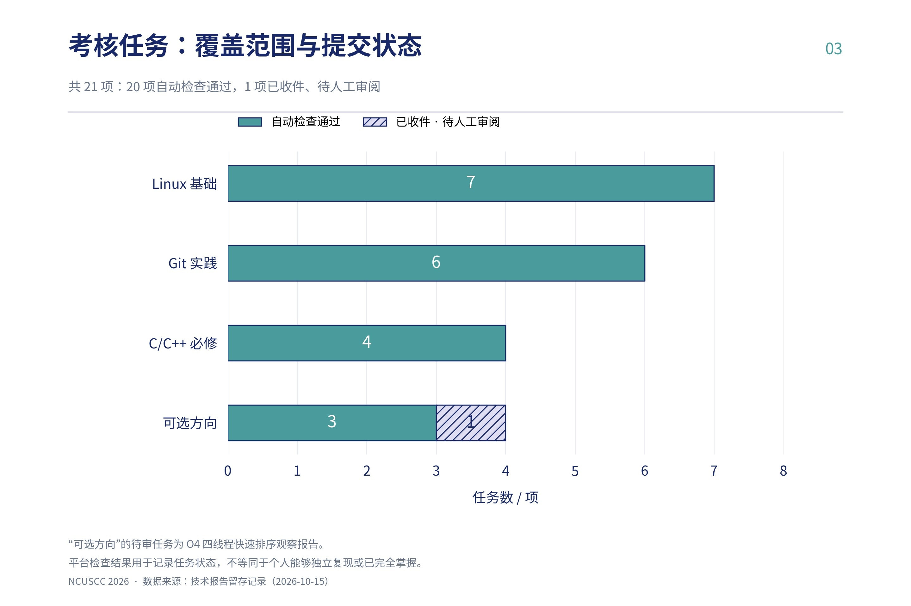

# NCUSCC 2026 秋季招新考核技术报告

## 详细目录

- [1. Linux 基础与系统管理](#section-2) · 第 7 页
  - [1.1 固定路径调用](#section-3) · 第 7 页
    - [固定路径与原始字节](#section-5) · 第 7 页
    - [实现与修复](#section-6) · 第 8 页
    - [验证结果](#section-7) · 第 8 页
    - [局限与后续优化](#section-8) · 第 8 页
  - [1.2 文件查找、密钥提取与拼接](#section-9) · 第 9 页
    - [递归查找、转存与顺序拼接](#section-11) · 第 9 页
    - [实现与修复](#section-12) · 第 10 页
    - [验证结果](#section-13) · 第 10 页
  - [1.3 最小字节修复](#section-14) · 第 11 页
    - [LF 前补位与逆向还原](#section-16) · 第 11 页
    - [实现与修复](#section-17) · 第 12 页
    - [验证结果](#section-18) · 第 12 页
    - [局限与后续优化](#section-19) · 第 12 页
  - [1.4 参数、环境与退出码](#section-20) · 第 13 页
    - [参数校验、环境传递与状态码映射](#section-22) · 第 13 页
    - [实现与修复](#section-23) · 第 15 页
    - [验证结果](#section-24) · 第 16 页
  - [1.5 后台进程管理](#section-25) · 第 16 页
    - [实例隔离、文件锁与进程身份核验](#section-27) · 第 16 页
    - [实现与修复](#section-28) · 第 18 页
    - [验证结果](#section-29) · 第 18 页
    - [局限与后续优化](#section-30) · 第 18 页
  - [1.6 服务账号与最小权限](#section-31) · 第 19 页
    - [权限归属与真实身份读写验证](#section-33) · 第 19 页
    - [实现与修复](#section-34) · 第 21 页
    - [验证结果](#section-35) · 第 21 页
  - [1.7 构建工具与日志排错](#section-36) · 第 22 页
    - [分阶段排错与日志重定向](#section-38) · 第 22 页
    - [实现与修复](#section-39) · 第 24 页
    - [验证结果](#section-40) · 第 24 页
- [2. Git 版本控制](#section-41) · 第 25 页
  - [2.1 初始化本地仓库](#section-42) · 第 25 页
    - [未诞生分支与空索引](#section-44) · 第 25 页
    - [实现与修复](#section-45) · 第 26 页
    - [验证结果](#section-46) · 第 26 页
  - [2.2 工作区与暂存区](#section-47) · 第 27 页
    - [三层状态与差异比较](#section-49) · 第 27 页
    - [实现与修复](#section-50) · 第 28 页
    - [验证结果](#section-51) · 第 28 页
  - [2.3 提交暂存区快照](#section-52) · 第 28 页
    - [索引快照与父提交](#section-54) · 第 28 页
    - [实现与修复](#section-55) · 第 29 页
    - [验证结果](#section-56) · 第 29 页
  - [2.4 恢复历史内容](#section-57) · 第 30 页
    - [仅恢复工作区，保留索引与提交](#section-59) · 第 30 页
    - [实现与修复](#section-60) · 第 31 页
    - [验证结果](#section-61) · 第 31 页
  - [2.5 分支分叉与合并](#section-62) · 第 31 页
    - [共同基线分叉与双亲合并](#section-64) · 第 31 页
    - [实现与修复](#section-65) · 第 33 页
    - [验证结果](#section-66) · 第 33 页
  - [2.6 快进与可逆修改](#section-67) · 第 33 页
    - [快进移动引用与反向提交](#section-69) · 第 33 页
    - [实现与修复](#section-70) · 第 35 页
    - [验证结果](#section-71) · 第 36 页
- [3. C/C++ 必修基础](#section-72) · 第 36 页
  - [3.1 读数统计](#section-73) · 第 36 页
    - [首值初始化与流式统计](#section-75) · 第 36 页
    - [实现与修复](#section-76) · 第 37 页
    - [验证结果](#section-77) · 第 37 页
  - [3.2 设备巡检记录](#section-78) · 第 38 页
    - [结构体分类汇总与并列优先](#section-80) · 第 38 页
    - [实现与修复](#section-81) · 第 39 页
    - [验证结果](#section-82) · 第 39 页
  - [3.3 固定容量读数窗口](#section-83) · 第 40 页
    - [UBSan 排错与环形窗口回绕](#section-85) · 第 40 页
    - [实现与修复](#section-86) · 第 42 页
    - [验证结果](#section-87) · 第 42 页
  - [3.4 多文件统计工具](#section-88) · 第 42 页
    - [编译链接、签名与宽整数一致性](#section-90) · 第 43 页
    - [实现与修复](#section-91) · 第 44 页
    - [验证结果](#section-92) · 第 45 页
    - [局限与后续优化](#section-93) · 第 45 页
- [4. C/C++ 可选方向](#section-94) · 第 45 页
  - [4.1 读数变化观察](#section-95) · 第 45 页
    - [GDB 断点与首项边界](#section-97) · 第 45 页
    - [实现与修复](#section-98) · 第 47 页
    - [验证结果](#section-99) · 第 47 页
  - [4.2 馆藏目录卡](#section-100) · 第 48 页
    - [共享地址、字符数组与长度判断](#section-102) · 第 48 页
    - [实现与修复](#section-103) · 第 49 页
    - [验证结果](#section-104) · 第 50 页
  - [4.3 借阅台账](#section-105) · 第 50 页
    - [库存状态转移与非法操作拒绝](#section-107) · 第 50 页
    - [实现与修复](#section-108) · 第 52 页
    - [验证结果](#section-109) · 第 52 页
  - [4.4 四线程快速排序观察](#section-110) · 第 52 页
    - [任务划分、线程汇合与计时边界](#section-112) · 第 53 页
    - [实现与修复](#section-113) · 第 55 页
    - [验证结果](#section-114) · 第 55 页
    - [局限与后续优化](#section-115) · 第 56 页
- [5. 总结与后续巩固方向](#section-116) · 第 56 页
  - [5.1 完成范围与平台提交结果](#section-117) · 第 56 页
  - [5.2 主要验证方法与结论边界](#section-118) · 第 57 页
  - [5.3 技术认识与后续学习内容](#section-119) · 第 57 页
- [附录 A. 任务与验证记录总表](#section-120) · 第 58 页
  - [Linux 基础与系统管理](#section-121) · 第 59 页
  - [Git 版本控制](#section-122) · 第 60 页
  - [C/C++ 必修基础](#section-123) · 第 61 页
  - [C/C++ 可选方向](#section-124) · 第 61 页
- [附录 B. 关键文件 SHA-256 与 Git 提交哈希](#section-125) · 第 62 页


<a id="section-1"></a>

## 任务范围与实验环境

本报告涵盖 21 项任务：Linux 必修 7 项、Git 必修 6 项、C/C++ 必修 4 项及可选方向 4 项。前 20 项已通过平台自动检查，四线程快速排序观察报告已收件、待人工审阅。

实验与验证记录来自 2026 年 10 月 12 日至 15 日的考核容器及实验环境。各关的 /workspace 为题目网页内的 Linux 容器目录，与本机 Windows 11、WSL2 环境相互独立。具体编译设置、测试规模及结论限制在各题中说明。

<a id="section-2"></a>

## 1. Linux 基础与系统管理模块（第 1～7 关）

> **环境说明**：各关中的 `/workspace` 是题目网页内的 Linux 容器目录，独立于本机 Windows 11 及本地 WSL2 环境。

<a id="section-3"></a>

### 1.1 第 1 关：找到文件，用正确路径调用程序

<a id="section-4"></a>

#### 题目目标与约束

* **文件与路径关系**：原始输入为 `/workspace/input.bin`；练习密钥存放在 `/workspace/cabinet/key.txt`（内容为 `MOON`）；处理程序 `/workspace/exam` 固定从 `/workspace/input` 读取输入，固定向 `/workspace/output` 写出结果；最终提交文件为 `/workspace/flag`。

* **数据完整性约束**：输入与输出均为二进制数据，流转过程必须原样保留字节。

<a id="section-5"></a>

#### 原理与思路

* **区分“原始文件存在”与“程序固定读取位置”**：`/workspace/input.bin` 不会自动被 `/workspace/exam` 识别，需先复制到 `/workspace/input`。

* **二进制复制与命令替换**：二进制数据直接使用 `cp` 复制，不使用 `echo`、文本编辑器或 `$(cat 二进制文件)` 中转，防止空字节被截断或换行符被改变；密钥文本使用 `"$(cat /workspace/cabinet/key.txt)"` 作为 `-e` 的参数传入（命令替换自动移除末尾换行，外层双引号防止空白拆分与通配符展开）。


<a id="section-6"></a>

#### 实现或修复

**【关键命令节选】**：

```
/workspace/exam --help
cp -n /workspace/input.bin /workspace/input
/workspace/exam -e "$(cat /workspace/cabinet/key.txt)"
cp -n /workspace/output /workspace/flag

# 检查命令
stat /workspace/flag
wc -c < /workspace/flag
cmp /workspace/output /workspace/flag

```

<a id="section-7"></a>

#### 验证结果

* 实际生成的 `/workspace/flag` 经 `stat` 与 `wc -c` 确认为 **16 字节普通文件**。

* `cmp /workspace/output /workspace/flag` 无输出且返回退出码 `0`，确认复制前后逐字节一致；平台显示“**检查通过**”。

<a id="section-8"></a>

#### 局限与可选优化

* **`cp -n` 在重做时的残留风险**：`cp -n` 在目标文件已存在时不覆盖，首次执行可防误删；但若在重做时目标已存在，它会静默保留旧文件。重做时应先核对目标内容再决定是否覆盖，或使用 `&&` 在确认 `/workspace/exam` 成功退出后再覆盖更新 `/workspace/flag`。

<a id="section-9"></a>

### 1.2 第 2 关：查找 A、B，提取密钥，再按顺序拼接

<a id="section-10"></a>

#### 题目目标与约束

* **目标**：在 `/workspace` 下递归定位分散存放的 A、B 两份输入文件，从 `/workspace/catalog/words.txt` 中筛出 `ACCESS_KEY=` 对应的练习密钥 `STAR`，分别调用 `/workspace/exam` 处理 A 与 B，最后按 **A → B** 顺序无分隔符拼接为 `/workspace/flag`。

* **路径覆盖与顺序约束**：程序仍读写固定的 `/workspace/input` 与 `/workspace/output`；拼接时不得添加标题、分隔线、空格或换行，且必须保证 `A → B` 顺序。

<a id="section-11"></a>

#### 原理与思路

* **递归查找与密钥提取**：

  * 使用 `find /workspace -type f -name 'signal-*.bin'` 查找普通文件（单引号防止 `*` 被当前 Shell 提前展开），确认 A 位于 `/workspace/archive/2026/signal-A.bin`，B 位于 `/workspace/inbox/signal-B.bin`。

  * 使用 `key=$(grep '^ACCESS_KEY=' /workspace/catalog/words.txt | cut -d= -f2-)` 提取密钥；`cut -d= -f2-` 保留第 2 个字段至最后一个字段，即使密钥值内部含有 `=` 也不会被截断。


* **中间结果转存与顺序拼接**：

  * 因第 2 次运行会覆盖 `/workspace/output`，处理完 A 后必须先将 `/workspace/output` 复制为 `/workspace/A.out`，再用 B 覆盖 `/workspace/input`（此处是有意替换工作输入，不能用 `cp -n`）。

  * 全程用 `&&` 串联，确保前一步退出码为 `0` 才继续；最后用 `cat /workspace/A.out /workspace/B.out > /workspace/flag` 覆盖写入完整字节流（不用 `>>` 避免重复追加导致长度翻倍）。


<a id="section-12"></a>

#### 实现或修复

**【关键命令节选】**：

```
find /workspace -type f -name 'signal-*.bin'
grep '^ACCESS_KEY=' /workspace/catalog/words.txt
key=$(grep '^ACCESS_KEY=' /workspace/catalog/words.txt | cut -d= -f2-)

cp /workspace/archive/2026/signal-A.bin /workspace/input &&
/workspace/exam -e "$key" &&
cp /workspace/output /workspace/A.out &&
cp /workspace/inbox/signal-B.bin /workspace/input &&
/workspace/exam -e "$key" &&
cp /workspace/output /workspace/B.out &&
cat /workspace/A.out /workspace/B.out > /workspace/flag

# 检查命令
wc -c /workspace/A.out /workspace/B.out /workspace/flag
cat /workspace/A.out /workspace/B.out > /workspace/expected.bin
cmp /workspace/expected.bin /workspace/flag

```

<a id="section-13"></a>

#### 验证结果

* 两次处理均成功，`A.out`、`B.out` 各为 **16 字节**，`/workspace/flag` 为 **32 字节普通文件**。

* 与重新按 `A → B` 拼接的 `expected.bin` 经 `cmp` 逐字节核对一致（排除了长度同为 32 字节但 `cat B A` 顺序颠倒的错误）；账户记录已确认本关通过。

<a id="section-14"></a>

### 1.3 第 3 关：根据日志，做最小的字节修复

<a id="section-15"></a>

#### 题目目标与约束

* **目标**：根据程序日志要求，使输入字节数为练习密钥 `NOVA`（4 字节）的整数倍，在保留末尾换行符 LF 的前提下对 `/workspace/input.txt` 做最小修改生成 `/workspace/input`，运行程序并将输出存为 `/workspace/flag`。

<a id="section-16"></a>

#### 原理与思路（含排错记录）

* **排错现象与原因**：原始 `/workspace/input.txt` 内容为 `REPAIR THIS SIGNAL\n`（含末尾 LF 共 **19 字节**），因 19 不能被密钥长度 4 整除而执行失败。

* **最小补位计算与修改**：按公式 `(4 - 19 % 4) % 4 = 1`，只需补 **1 个空格**即可达到 20 字节（公式末尾再取一次余数，可保证原长度已能被 4 整除时补 `0` 个字节而非多补 4 个）。使用 `sed '$s/$/ /' /workspace/input.txt > /workspace/input` 在最后一行末尾（LF 之前）追加 1 个空格（`0x20`），输出时 `sed` 自动保留末尾 LF（`0x0a`）。


* **不可见字符检查与逆向还原验证**：`cat` 无法直观区分末尾空格与换行格式（如 LF `0a` 与 CRLF `0d 0a`），因此使用 `od -An -tx1` 查看十六进制单字节序列；再用 `sed '$s/ $//'` 删去最后一行末尾新增的 1 个空格，通过 `cmp` 与原文件 `input.txt` 比对，证明除该空格外其余字节未变。


<a id="section-17"></a>

#### 实现或修复

**【关键命令节选】**：

```
wc -c < /workspace/input.txt
sed '$s/$/ /' /workspace/input.txt > /workspace/input
wc -c < /workspace/input
od -An -tx1 /workspace/input
/workspace/exam -e 'NOVA' &&
cp /workspace/output /workspace/flag

# 逆向核对命令
sed '$s/ $//' /workspace/input > /workspace/restored-check.txt
cmp /workspace/input.txt /workspace/restored-check.txt
cmp /workspace/output /workspace/flag

```

<a id="section-18"></a>

#### 验证结果

* 修复后的 `/workspace/input` 为 **20 字节**，`od -An -tx1` 确认末尾为 `20 0a`；逆向去掉新增空格后的 `restored-check.txt` 与原 `input.txt` 经 `cmp` 逐字节一致。

* 程序日志显示 `exit=0`，`/workspace/flag` 为 **20 字节普通文件**，输出复制校验一致；账户记录已确认本关通过。

<a id="section-19"></a>

#### 局限与可选优化

* **文本补位方法的适用边界**：该 `sed` 写法仅适用于带 LF 的普通文本文件，不能泛化为任意二进制文件的通用补位方法。

<a id="section-20"></a>

### 1.4 第 4 关：写一个参数、环境和退出码都正确的脚本

<a id="section-21"></a>

#### 题目目标与约束

编写 POSIX Shell 脚本 `route.sh MODE ITEM`，满足以下约束：

* **参数约束**：必须恰好 2 个参数；`MODE` 仅限 `ok`、`retry`、`fatal`；`ITEM` 长度为 1～32 个 ASCII 英文字母或数字；非法参数向标准错误输出用法并退出 `64`，不生成结果文件。

* **环境约束**：`TASK_TOOL_DIR` 与 `ROUTE_RESULT` 必须非空（否则退出 `70`）；从 `/workspace/job.env` 读取配置并 `export ACCESS_TOKEN` 给子进程；将 `TASK_TOOL_DIR` 前置到 `PATH` 后调用 `task-probe`。

* **退出码与结果映射**：

| `task-probe` 退出码 | 结果文件 `ROUTE_RESULT` 内容 | 脚本退出码 | 
| ----- | ----- | ----- | 
| `0` | 工具输出的回执文本 | `0` | 
| `11` | `retry:ITEM` | `75` | 
| `23` | `rejected:ITEM` | `65` | 
| 其他 | **本次调用不执行结果写入**（保留路径原有旧文件） | 原样传出工具退出码 | 

结果写入失败退出 `74`。

<a id="section-22"></a>

#### 原理与思路

* **前置内建校验与环境变量传递**：脚本固定 `LC_ALL=C` 并 `export`；在读取配置与调用工具前，先用 `[ "$#" -eq 2 ]`、`case` 模式匹配和 `${#2}` 检查参数合法性。使用 `. /workspace/job.env` 在当前 Shell 中读取变量，并显式 `export ACCESS_TOKEN` 使其传给子进程；`PATH="$TASK_TOOL_DIR:${PATH:-/usr/bin:/bin}"` 前置工具目录并保留系统基础命令查找路径。


* **非零业务退出码捕获与结果写出**：因 `11`、`23` 为正常业务状态码，不用 `set -e`，而是通过 `if receipt=$(task-probe "$1" "$2"); then probe_status=0; else probe_status=$?; fi` 立即捕获 `$?`；用固定格式 `printf '%s\n' "$result" > "$ROUTE_RESULT"` 写出回执（避免 `echo` 对特殊字符或选项的误处理），并用双引号保护含空格路径。


<a id="section-23"></a>

#### 实现或修复

**【完整脚本（与 `route-level-4.sh` 一致，不含真实令牌）】**：

```
#!/bin/sh

LC_ALL=C
export LC_ALL

usage() {
    printf '%s\n' 'usage: route.sh MODE ITEM' >&2
    exit 64
}

[ "$#" -eq 2 ] || usage
case "$1" in
    ok|retry|fatal) ;;
    *) usage ;;
esac
case "$2" in
    ''|*[!A-Za-z0-9]*) usage ;;
esac
[ "${#2}" -le 32 ] || usage

if [ -z "${TASK_TOOL_DIR:-}" ] || [ -z "${ROUTE_RESULT:-}" ]; then
    printf '%s\n' 'TASK_TOOL_DIR and ROUTE_RESULT are required' >&2
    exit 70
fi

. /workspace/job.env || exit 70
export ACCESS_TOKEN
PATH="$TASK_TOOL_DIR:${PATH:-/usr/bin:/bin}"
export PATH

if receipt=$(task-probe "$1" "$2"); then
    probe_status=0
else
    probe_status=$?
fi

case "$probe_status" in
    0)  result=$receipt; route_status=0 ;;
    11) result="retry:$2"; route_status=75 ;;
    23) result="rejected:$2"; route_status=65 ;;
    *)  exit "$probe_status" ;;
esac

printf '%s\n' "$result" > "$ROUTE_RESULT" || exit 74
exit "$route_status"

```

<a id="section-24"></a>

#### 验证结果

* 完成了 **42 项工作区检查，全部通过**；平台自动提交后显示“**检查通过**”。

<a id="section-25"></a>

### 1.5 第 5 关：启动、识别、观察和停止后台进程（`linux-process-control`）

<a id="section-26"></a>

#### 题目目标与约束

编写 Bash 进程管理脚本（部署路径 `/workspace/manage.sh`，完整实现保存在 `manage-level-5.sh`），支持 `start`、`status`、`report`、`stop` 四种操作，管理 `/opt/recruitment/bin/slow-worker`。用 `WORK_DIR`（未设置时默认 `/workspace`）隔离不同工作目录的实例：

* `start`：已有符合身份的本实例 worker 时直接复用；否则后台启动，并等待 `heartbeat.log` 中出现本进程 PID 后返回 `0`。

* `status`：输出 `running`（退出码 `0`）或 `stopped`（退出码 `1`）。

* `report`：采集该进程的 `ps`、`top` 信息写入 `$WORK_DIR/resource.txt`（退出码 `0`）。

* `stop`：核对进程身份后发送 `TERM`，等待进程向 `stopped.log` 写入 PID 并退出后清理 `worker.pid`（成功或本已停止均退出 `0`）。非法参数退出 `64`。

<a id="section-27"></a>

#### 原理与思路

* **工作目录规范化、`flock` 排他锁与子进程关闭锁描述符**：

  * 使用 `WORK_DIR=$(cd -- "$WORK_DIR" && pwd -P)` 解析符号链接，统一为物理绝对路径；区分进程当前工作目录（`cwd`）与环境变量 `WORK_DIR`，脚本对两者均设置、均核对。

  * 打开文件描述符 `9`（`exec 9>"$WORK_DIR/.manage.lock"`）并执行 `flock -w 1 9`，防止并发管理操作冲突。

  * **关键细节**：后台子进程默认继承父进程打开的文件描述符。启动 `slow-worker` 的子 Shell 在执行 `nohup` 前必须先执行 `exec 9>&-` 关闭描述符 `9`，否则后台 worker 会持续占用 `.manage.lock`，导致后续管理命令无法获取锁。

  * 启动后最多检查 24 次（每次间隔 `0.025` 秒），确认身份匹配且 `grep -Fxq "$pid" "$WORK_DIR/heartbeat.log"` 出现本 PID 心跳才宣告成功。


* **`/proc` 五维身份核验、原子报告与 `TERM` 优雅停止**：

  * PID 会被系统复用，`worker.pid` 只是查找线索。脚本依次核对：① PID 为非零开头的正整数；② `/proc/PID/stat` 可读且状态不为 `Z`（僵尸）或 `X`（死亡）；③ `/proc/PID/cmdline`（按 `\0` 分隔）参数恰好为 `/usr/bin/python3` 和 `/opt/recruitment/bin/slow-worker`；④ `/proc/PID/cwd` 等于规范化 `WORK_DIR`；⑤ `/proc/PID/environ`（按 `\0` 分隔）中的 `WORK_DIR` 等于本实例 `WORK_DIR`。当 `worker.pid` 缺失或失效时，通过 `pgrep -f` 查找候选进程并逐一执行上述五维核验，找回本目录 worker 且绝不误杀其他目录的同名进程。

  * `report` 先用 `mktemp` 在工作目录内生成临时报告，收集 `ps` 与 `top` 成功并再次确认 worker 身份后，用 `mv` 替换 `resource.txt`。

  * `stop` 再次核对身份后发送 `kill -TERM -- "$pid"`（允许 worker 执行信号处理逻辑写出 `stopped.log`，不擅自升级不可捕获的 `SIGKILL`），最多轮询 40 次（每次 `0.025` 秒）确认本实例进程退出后才删除 `worker.pid`。


<a id="section-28"></a>

#### 实现或修复

**【关键代码节选（完整实现原文件名：`manage-level-5.sh`）】**：

```
# 1. 排他锁获取
exec 9>"$WORK_DIR/.manage.lock" || exit 1
flock -w 1 9 || exit 1

# 2. 后台启动片段
(
    exec 9>&-
    cd -- "$WORK_DIR" || exit 1
    exec nohup "$worker" </dev/null >>"$WORK_DIR/worker.log" 2>&1
) &
pid=$!
printf '%s\n' "$pid" >"$pidfile"

# 3. 资源报告采集命令
ps -ww -p "$pid" -o pid,ppid,stat,etime,%cpu,%mem,args
top -b -n 1 -c -w 512 -p "$pid"

# 4. 正常停止信号发送
kill -TERM -- "$pid"

```

<a id="section-29"></a>

#### 验证结果

* 完成了 **37 项容器检查，全部通过**；当次实测最慢一次 `start` 耗时 **0.524 秒**（属本次测试观测值，不代表任意机器或负载下的固定耗时），全部测试进程已清理；平台显示“**检查通过**”。

<a id="section-30"></a>

#### 局限与可选优化

* **竞态窗口与协同锁边界**：普通 PID 与 `/proc` 检查在“核对身份”到“发送信号”之间仍存在短暂的竞态窗口；`.manage.lock` 仅协调遵守同一锁约定的管理脚本调用，不能阻止完全绕过管理脚本的其他程序自行操作 worker。

<a id="section-31"></a>

### 1.6 第 6 关：交给服务账号（`linux-permissions`）

<a id="section-32"></a>

#### 题目目标与约束

在 root 训练容器中编写 `/workspace/setup-account.sh`（完整脚本保存在 `setup-account-level-6.sh`），将任务文件 `TASK_FILE`（默认 `/workspace/task.txt`）交给专用系统服务账号 `archiver`：主组为系统组 `archive`，UID 在 `200～999` 之间，不创建主目录，登录 Shell 为 `/usr/sbin/nologin`；设置文件归属与 `640` 权限，使 `archiver` 可读而已有账号 `visitor` 被拒绝读取，最后由 `archiver` 动态读取任务码写入 `/workspace/flag`。

<a id="section-33"></a>

#### 原理与思路（含容器 root 权限观察记录）

* **初始 `000` 权限下的容器 root 现象**：`TASK_FILE` 初始属于 `root:root`、权限为 `000`。实操观察到即使当前身份是容器 root，直接 `cat` 也返回 `Permission denied`，补上属主读权限（`chmod u+r`）后才读到两行任务说明（第 1 行 `任务码：ARCHIVE-READY-6`，第 2 行说明写入 `/workspace/flag` 的格式）。这表明容器内的 root 仍可能受到容器能力和隔离设置约束。

* **幂等身份核验与 `640` 最小权限配置**：

  * 脚本先通过 `getent group archive` 与 `getent passwd archiver` 查询系统记录：不存在时才调用 `groupadd -r` 与 `useradd -r` 创建；若已存在，则核对 GID（`1～999`）、UID（`200～999`）、主组 GID 匹配、`/usr/sbin/nologin` Shell 以及主目录未实际存在且不是符号链接。已有身份不合规时明确报错退出，不静默改造现有账号，也不在错误账号上继续修改文件。

  * 校验 `TASK_FILE` 是普通文件且非符号链接，拒绝 `/workspace/flag` 指向符号链接；执行 `chown archiver:archive -- "$task"` 与 `chmod 640 -- "$task"`（属主 `rw-`、属组 `r--`、其他 `---`），同时注意读取文件除需文件自身 `r` 权限外，还需对每一层父目录具有搜索/穿越权限 `x`。


* **正负向真实身份读取验证与动态任务码提取**：

  * `/usr/sbin/nologin` 阻止交互式登录会话，但 root 可通过 `runuser -u archiver -- cat -- "$task"` 直接以该身份运行指定命令。

  * 验证 `visitor` 拒读时，脚本**先确认能够切换为 `visitor` 身份，再检查其读文件应当失败**，从而区分“账号无法切换”与“文件权限正确拒绝读取”。

  * 以 `archiver` 身份用 `awk` 动态读取 `任务码：` 或 `任务码:` 后的内容（兼容同行或下一条非空行，并移除行末 CR），通过 `printf '%s\n' "$code" > /workspace/flag` 精确补回一个 LF，不写死 `ARCHIVE-READY-6`。


<a id="section-34"></a>

#### 实现或修复

**【关键命令节选（完整实现原文件名：`setup-account-level-6.sh`）】**：

```
groupadd -r archive
useradd -r -K SYS_UID_MIN=200 -K SYS_UID_MAX=999 \
    -g archive -M -d /nonexistent -s /usr/sbin/nologin archiver
chown archiver:archive -- "$task"
chmod 640 -- "$task"

# 验证与写出命令
getent passwd archiver
getent group archive
stat -c '%U:%G %a %n' /workspace/task.txt
runuser -u archiver -- cat -- /workspace/task.txt
runuser -u visitor -- cat -- /workspace/task.txt
printf '%s\n' "$code" > /workspace/flag

```

<a id="section-35"></a>

#### 验证结果

* **22 项容器检查全部通过**：实际 UID/GID 为 `999/999`，主组为 `archive`，Shell 为 `/usr/sbin/nologin`，主目录字段为 `/nonexistent` 且路径未创建；任务文件为 `archiver:archive`、`640`。

* `archiver` 读取成功，`visitor` 读取返回 `Permission denied`；重复执行保持幂等；临时将 `archiver` 的 Shell 改为 `/bin/sh` 时脚本明确拒绝且未改变 `flag`（随后已恢复）；含空格备用 `TASK_FILE`、初始 `000` 权限及跨行任务码均通过动态读取测试。

* 最终 `/workspace/flag` 为 `ARCHIVE-READY-6\n`（**16 字节**），平台显示“**检查通过**”。

<a id="section-36"></a>

### 1.7 第 7 关：装好工具并读日志（`linux-build-logs`）

<a id="section-37"></a>

#### 题目目标与约束

准备 C 编译环境并修复 `/workspace/hello.c`，通过固定构建脚本 `/workspace/build.sh`（`gcc -std=c11 -Wall -Wextra -Werror -o /workspace/hello /workspace/hello.c > /workspace/build.log 2>&1`）生成 `/workspace/hello`，再把程序以 `foundation` 为参数的**实际标准输出**保存为 `/workspace/flag`，同时向 `/workspace/run.log` 追加 `processed:foundation\n`（完整实现保存在 `setup-build-level-7.sh`、`hello-level-7.c`）。

<a id="section-38"></a>

#### 原理与思路（含分阶段排错记录）

* **第一阶段（工具环境排错）**：

  * **现象**：首次执行 `/workspace/build.sh` 失败，`build.log` 提示 `gcc: command not found`。

  * **原因**：编译器尚未安装；经 `dpkg-query -W` 查询，本地仓库 `file:/opt/repo` 提供 `build-essential`（`12.10ubuntu1`），但预装的练习包 `ncuscc-build-guard`（`1.0`）声明了 `Conflicts: build-essential`。

  * **修改与验证**：在 `setup-build.sh` 中先运行 `apt-get update`，再用 `apt-get -s install build-essential` 模拟安装并逐行检查 `Remv` 动作——**仅接受移除 `ncuscc-build-guard`**（若出现其他移除目标则明确失败退出）；随后执行 `apt-get install -y --no-install-recommends build-essential`，安装后再次查询确认 `build-essential`、`apt`、`dpkg`、`libc6` 状态均为 `install ok installed`，冲突包已移除且 `gcc`、`make` 可找到。

* **第二阶段（C11 源码排错与参数/I/O 校验）**：

  * **现象**：安装编译器后重新编译原源码，`build.log` 报告 `/workspace/hello.c:9:34` 处 `expected ';' before 'return'`。

  * **原因**：原语句 `printf("hello:%s\n", argv[1])` 末尾缺少分号 `;`。

  * **修改**：补齐分号；同时增加 `argc == 2`、`argv[1][0] != '\0'` 及逐字节 `A–Z`、`a–z`、`0–9` 校验（非法参数返回 `64` 且不写运行日志）；使用 `fopen(..., "a")` 追加运行日志，并检查 `fopen`、`fprintf`、`fclose`、`printf` 与 `fflush(stdout)` 是否成功（I/O 错误返回 `1`，正常返回 `0`）。



* **构建日志覆盖与运行日志追加分离**：

  * `build.sh` 中的 `> /workspace/build.log 2>&1` 每次用 `>` 覆盖构建日志，反映最新一次编译状态；`hello.c` 中用 `fopen("/workspace/run.log", "a")` 追加运行记录，保留历次运行历史。

  * 用 `&&` 串联 `setup-build.sh`、`build.sh` 与 `/workspace/hello foundation > /workspace/flag`，防止编译失败时误运行旧二进制。


<a id="section-39"></a>

#### 实现或修复

**【关键命令与源码修复节选（完整实现原文件名：`setup-build-level-7.sh`、`hello-level-7.c`）】**：

```
# 诊断命令
cat /workspace/build.sh
tail -n 30 /workspace/build.log
command -v gcc
dpkg-query -W build-essential ncuscc-build-guard
apt-get -s install build-essential

# 串联安装、编译与运行
bash /workspace/setup-build.sh &&
bash /workspace/build.sh &&
/workspace/hello foundation > /workspace/flag

```

C 语句修复对比：

```
/* 修复前：缺少结尾分号 */
printf("hello:%s\n", argv[1])

/* 修复后：补齐分号 */
printf("hello:%s\n", argv[1]);

```

<a id="section-40"></a>

#### 验证结果

* **27 项容器检查全部通过**：`setup-build.sh` 第二次执行保持幂等；`build.sh` 重新编译退出 `0`，`build.log` 为空。

* 正向测试（单字母、数字、字母数字混合、`foundation` 及 4096 个 ASCII 字符参数）均产生精确标准输出并正确追加 `run.log`；负向测试（无参数、空串、两个参数，以及含空格、连字符、中文或 `%s` 的参数）均返回 `64` 且不写运行日志。

* 最终 `/workspace/flag` 为程序实际执行 `foundation` 产生的 `hello:foundation\n`（**17 字节**），`run.log` 末尾正确追加 `processed:foundation\n`；平台显示“**检查通过**”。

<a id="section-41"></a>

## 2. Git 版本控制模块（6 关）

> **模块说明**：各关均使用独立本地仓库 `/workspace/repo`，不混用跨关提交 ID，无需配置远程或推送；网页“提交评测”按钮用于触发平台检查仓库状态，不同于创建版本历史的 `git commit`。

<a id="section-42"></a>

### 2.1 Git 基础：Git 就在本地（`git-foundation`）

<a id="section-43"></a>

#### 题目目标与约束

在 `/workspace/repo` 建立独立的本地 Git 仓库，令 `HEAD` 指向 `main`，保持 `notes.txt` 内容原样、未暂存；要求仓库**没有暂存条目、没有提交**。

<a id="section-44"></a>

#### 原理与思路

* **未诞生分支与空索引**：`git init -b main` 初始化 `.git` 目录并将 `HEAD` 以符号引用形式指向 `refs/heads/main`，不会自动暂存文件。由于尚无第一次提交，`git symbolic-ref --short HEAD` 输出 `main`，而 `git rev-parse --verify HEAD` 返回非零（未诞生分支）；此时 `git ls-files --stage` 为空，`notes.txt` 在 `git status --short` 中显示为 `?? notes.txt`。


<a id="section-45"></a>

#### 实现或修复

**【关键命令节选】**：

```
cd /workspace/repo
sha256sum notes.txt
git init -b main
sha256sum notes.txt

# 只读检查命令
git rev-parse --show-toplevel
git symbolic-ref --short HEAD
git status --short -- notes.txt
git ls-files --stage
git rev-parse --verify HEAD

```

<a id="section-46"></a>

#### 验证结果

* 仓库根目录为 `/workspace/repo`，`HEAD` 符号引用为 `main`，状态为 `?? notes.txt`，索引为空，`HEAD` 无可解析提交。

* `notes.txt` 保持 `local git practice\n`（**19 字节**），前后 SHA-256 一致（`26e87246954c2140bad935aaf75b0a91c4a3efb0db7a0b847f1440a75ccc24bc`）；平台显示“**检查通过**”。

<a id="section-47"></a>

### 2.2 Git 检查：看清工作区和暂存区（`git-inspect`）

<a id="section-48"></a>

#### 题目目标与约束

在已有提交基线 `c0` 上，只修改工作区的 `notes.txt` 为三行目标文本（`local git practice\n\nfirst local note\n`，共 **37 字节**），保持 `HEAD` 和暂存区（索引）基线不变，不执行 `git add` 或 `git commit`。

<a id="section-49"></a>

#### 原理与思路

* **短状态两列含义与三类 `diff` 对照**：`git status --short` 的前两列 `XY` 中，`X` 为索引相对 `HEAD` 的状态，`Y` 为工作区相对索引的状态；本关只改工作区，因此显示为 ` M notes.txt`（首列为空格）。

| 命令 | 比较两端 | 本关预期结果 | 
| ----- | ----- | ----- | 
| `git diff -- notes.txt` | 工作区与索引 | 显示新增空行和 `first local note` | 
| `git diff --cached -- notes.txt` | 索引与 `HEAD` | 为空（未暂存新内容） | 
| `git diff HEAD -- notes.txt` | 工作区与 `HEAD` | 与普通 `git diff` 显示相同的净差异 | 


<a id="section-50"></a>

#### 实现或修复

**【关键命令节选】**：

```
cd /workspace/repo
printf '%s\n' 'local git practice' '' 'first local note' > notes.txt

# 只读核对命令
git rev-parse HEAD
git ls-files --stage
git status --short
git diff -- notes.txt
git diff --cached -- notes.txt
od -An -tx1 notes.txt

```

<a id="section-51"></a>

#### 验证结果

* 工作区 `notes.txt` 逐字节符合目标（**37 字节**，含中间空行 `0a 0a` 与末尾 `0a`）；普通 `git diff` 显示新增空行和 `first local note`，`git diff --cached --exit-code` 无输出且返回 `0`。

* `HEAD` 保持基线提交 `0acac9a4536e3f6fcf5df349718b703b43941351`（`seed: baseline`），索引完整条目与修改前一致；平台显示“**检查通过**”。

<a id="section-52"></a>

### 2.3 Git 提交：留下第一个版本（`git-commit`）

<a id="section-53"></a>

#### 题目目标与约束

在已有种子提交 `c0` 上，将 `notes.txt` 修改为 `local git practice\n\nfirst local note\n`（**37 字节**），新增且只新增 **1 个提交**，提交说明精确为 `learn: first local commit`；完成后 `HEAD` 位于 `main`，工作区与索引均干净。

<a id="section-54"></a>

#### 原理与思路

* **提交暂存区快照与父提交核对**：先记录初始 `baseline_head=$(git rev-parse HEAD)`，修改文件后用 `git add -- notes.txt` 限定路径放入索引，经 `git diff --cached` 核对后执行 `git commit -m 'learn: first local commit'`。随后通过 `git show HEAD:notes.txt` 读取提交内快照、通过 `git log -1 --format=%P` 检查全部父提交列表（确认只有基线一枚哈希）、通过 `git rev-list --count "${baseline_head}..HEAD"` 确认新增提交计数为 `1`。



<a id="section-55"></a>

#### 实现或修复

**【关键命令节选】**：

```
cd /workspace/repo
baseline_head=$(git rev-parse HEAD)
printf '%s\n' 'local git practice' '' 'first local note' > notes.txt
git add -- notes.txt
git diff --cached -- notes.txt
git commit -m 'learn: first local commit'

# 只读核对命令
git status --short
git symbolic-ref --short HEAD
git show HEAD:notes.txt
git log -1 --format=%B
git rev-parse HEAD^
git log -1 --format=%P
git rev-list --count "${baseline_head}..HEAD"

```

<a id="section-56"></a>

#### 验证结果

* 新提交为 `141808939bffaedccf923266ea7d61b3401637b3`，提交说明精确为 `learn: first local commit`，唯一父提交为原基线 `0acac9a4536e3f6fcf5df349718b703b43941351`，新增提交计数为 `1`。

* 当前分支为 `main`，`git status --short` 输出为空，工作区文件与 `HEAD:notes.txt` 逐字节一致（37 字节）；平台显示“**检查通过**”。

<a id="section-57"></a>

### 2.4 Git 恢复：找回历史中的内容（`git-recover`）

<a id="section-58"></a>

#### 题目目标与约束

本关独立仓库包含两次提交：`c0` 中 `notes.txt` 为 `version one`，`c1` 中为 `version two`，当前工作区另有临时修改。本次选择 `restore` 方案：**让工作区回到 `c0` 的文件内容，同时保持 `HEAD` 和索引都在 `c1` 不变**。

<a id="section-59"></a>

#### 原理与思路

* **显式指定 `--source` 与 `--worktree` 的作用条件**：`git restore` 的影响范围取决于所带参数——若只写 `git restore notes.txt`，默认从当前索引（`c1`）恢复工作区，只能得到 `version two`；若带 `--staged` 则会修改暂存区（索引）。本题要求只把工作区恢复为 `c0` 并保持暂存区与 `HEAD` 留在 `c1` 不变，因此先解析 `recovery_source=$(git rev-parse HEAD^)`（注意 `c0`、`c1` 是题面称呼而非已有标签），再显式传入 `--source="$recovery_source" --worktree` 仅将 `c0` 的文件取回工作区，不改索引也不移动 `HEAD`。

* **`restore` 与 `revert` 的区别**：

| 操作 | 主要作用 | 是否创建新提交 | 
| ----- | ----- | ----- | 
| 本次 `git restore --source="$recovery_source" --worktree` | 把选定历史快照中的文件取回工作区，索引与 `HEAD` 不变 | 不创建；原提交历史不变 | 
| 通常的 `git revert 提交` | 反转指定提交引入的改动并记入历史 | 创建反向提交，保留原提交 | 


<a id="section-60"></a>

#### 实现或修复

**【关键命令节选】**：

```
cd /workspace/repo
git log -2 --oneline
git show HEAD:notes.txt
git show HEAD^:notes.txt
git diff -- notes.txt
baseline_head=$(git rev-parse HEAD)
baseline_index=$(git ls-files --stage)
recovery_source=$(git rev-parse HEAD^)

# 先把临时原文复制到仓库外的 /workspace/notes-before-recover.8mt7Kx，再恢复
git restore --source="$recovery_source" --worktree -- notes.txt

# 核对命令
git show "$recovery_source:notes.txt" | cmp - notes.txt
test "$(git rev-parse HEAD)" = "$baseline_head"
test "$(git ls-files --stage)" = "$baseline_index"
git diff --cached --exit-code
git status --short

```

<a id="section-61"></a>

#### 验证结果

* 工作区 `notes.txt` 已逐字节恢复为 `c0`（`28f4733fade13bcecd2d3913d944d8f4c751d356`）中的 `version one`。

* `HEAD` 保持 `c1`（`63a7688938d3974e7a2a783f3de2f555b9e511a2`），完整索引条目未变，暂存区差异为空且退出码为 `0`，短状态显示预期的 ` M notes.txt`；平台显示“**检查通过**”。

<a id="section-62"></a>

### 2.5 Git 分支合并：让两条历史汇合（`git-branch-merge`）

<a id="section-63"></a>

#### 题目目标与约束

从同一个初始提交 `c0` 分出 `main` 和 `topic`：`main` 只修改 `main.txt` 为 `main ready\n`，`topic` 只修改 `topic.txt` 为 `topic ready\n`，各提交 1 次；最后在 `main` 合入 `topic`，产生含两个父提交的合并提交，同时保留两侧内容与 `topic` 分支引用。

<a id="section-64"></a>

#### 原理与思路

* **同基线分叉与双亲合并**：先记录共同基线 `c0=$(git rev-parse HEAD)` 并执行 `git branch topic "$c0"` 创建分支引用（避免在 `main` 提交后再建 `topic` 导致线性串联）。两侧分别暂存指定文件并提交后，切回 `main` 执行 `git merge --no-ff topic -m 'merge: topic into main'`：

  * 合并提交的 `HEAD^1` 为合并前的 `main` 提交，`HEAD^2` 为被合入的 `topic` 提交；

  * `main` 引用移至合并提交，而 `topic` 引用仍停留在 `topic` 侧提交上。




<a id="section-65"></a>

#### 实现或修复

**【关键命令节选】**：

```
cd /workspace/repo
c0=$(git rev-parse HEAD)
git branch topic "$c0"
printf '%s\n' 'main ready' > main.txt
git add -- main.txt
git commit -m 'learn: prepare main'
main_change=$(git rev-parse HEAD)

git switch topic
printf '%s\n' 'topic ready' > topic.txt
git add -- topic.txt
git commit -m 'learn: prepare topic'
topic_change=$(git rev-parse HEAD)

git switch main
git merge --no-ff topic -m 'merge: topic into main'

# 只读核对命令
git log --graph --oneline --all
git log -1 --format=%P
git rev-parse HEAD^1
git rev-parse HEAD^2
git rev-parse topic
git show HEAD:main.txt
git show HEAD:topic.txt
git status --short

```

<a id="section-66"></a>

#### 验证结果

* 共同基线为 `5746d7e`；`main` 侧提交 `43b11c2` 只改 `main.txt`，`topic` 侧提交 `cf5e2ba` 只改 `topic.txt`，二者均只有 `5746d7e` 这一个父提交。

* 合并提交 `7026fbe` 的完整父列表依次为 `43b11c2 cf5e2ba`，`topic` 仍指 `cf5e2ba`，相对基线恰好新增 **3 个可达提交**；两份文件逐字节符合目标，`notes.txt` 保持原样，工作区与索引干净；平台显示“**检查通过**”。

<a id="section-67"></a>

### 2.6 Git 综合：完成可逆修改（`git-capstone`）

<a id="section-68"></a>

#### 题目目标与约束

在 `trial` 分支把 `notes.txt` 改成 `local git practice\n\nfirst local note\n`（**37 字节**），用精确说明 `learn: first local commit` 创建提交；将它合入 `main`，再用 `revert` 撤销其内容变化。要求最终文件回到基线，工作区与索引干净，但修改和撤销这两次提交都留在历史中，且 `trial` 保留在原修改提交上。

<a id="section-69"></a>

#### 原理与思路

* **`--ff-only` 快进移动引用**：因 `main` 在创建 `trial` 后无新增提交，`main` 是 `trial` 的祖先；执行 `git merge --ff-only trial` 直接将 `main` 引用向前移动到修改提交，不产生合并提交。


* **`git revert` 保留历史并还原文件树**：在 `main` 上执行 `git revert --no-edit "$trial_commit"`，针对修改提交生成应用相反改动的新提交 `b5dd581`。最终提交顺序为“基线 `0acac9a` → 修改 `184c5f2`（`trial`）→ 反向提交 `b5dd581`（`main`）”，`main` 的文件树对象 `HEAD^{tree}` 与基线树完全一致，同时两次提交均保留在历史中。


<a id="section-70"></a>

#### 实现或修复

**【关键命令节选】**：

```
cd /workspace/repo
baseline_head=$(git rev-parse HEAD)
baseline_tree=$(git rev-parse 'HEAD^{tree}')
git switch -c trial
printf '%s\n' 'local git practice' '' 'first local note' > notes.txt
git add -- notes.txt
git diff --cached -- notes.txt
git commit -m 'learn: first local commit'
trial_commit=$(git rev-parse HEAD)

git switch main
git merge --ff-only trial
git revert --no-edit "$trial_commit"

# 只读核对命令
git log --graph --oneline --all
git log -1 --format=%P
git show -s --format=%P "$trial_commit"
git rev-parse trial
git rev-list --count "${baseline_head}..HEAD"
test "$(git rev-parse 'HEAD^{tree}')" = "$baseline_tree"
git show "$baseline_head:notes.txt" | cmp - notes.txt
git symbolic-ref --short HEAD
git status --short

```

<a id="section-71"></a>

#### 验证结果

* 基线为 `0acac9a`，`trial` 修改提交为 `184c5f2`（消息为 `learn: first local commit`），合入时显示 `Fast-forward`，`main` 反向提交为 `b5dd581`；父提交链按“基线 → 修改 → 反向提交”单线连接，`trial` 仍指 `184c5f2`，相对基线恰好新增 **2 个提交**。

* `HEAD^{tree}` 与 `$baseline_tree` 相等，`notes.txt` 逐字节恢复，`main` 工作区与索引干净；平台显示“**检查通过**”。

<a id="section-72"></a>

## 3. C/C++ 必修基础模块（第 1～4 关）

<a id="section-73"></a>

### 3.1 C/C++ 第 1 关：读数统计（`cpp-build-run`）

<a id="section-74"></a>

#### 题目目标与约束

* **目标**：从标准输入读取数量 `n`（`1 ≤ n ≤ 10000`）及 `n` 个整数（每个值在 `[-1000, 1000]`），使用 C++17 实现，依次输出 `count=数量`、`sum=总和`、`min=最小值`、`max=最大值` 四行（等号两边无空格，每行以 LF 结束），正常退出码为 `0`。

* **源码入口约束**：工作区根目录只能在 `main.c` 与 `main.cpp` 中保留一个，本关采用 `main.cpp`（完整源码原文件名：`readings-cpp-build-run.cpp`）。

<a id="section-75"></a>

#### 原理与思路

* **首值初始化与单次扫描**：先读取第 1 个值 `value`，将 `sum`、`minimum`、`maximum` 都初始化为它，再循环 `i = 1` 到 `n - 1` 读取剩余 `n - 1` 个数并在线更新。相比将极值初始化为 `0`（在全正数或全负数输入下会出错），首值初始化可正确处理正数、负数、零及 `n = 1` 单元素情况。

* **复杂度与数值范围**：不保存整个数组，时间复杂度为 **O(n)**，额外空间复杂度为 **O(1)**；总和绝对值最大为 `10000 × 1000 = 10^7`，32 位有符号 `int` 足够容纳。


<a id="section-76"></a>

#### 实现或修复

**【关键代码与编译命令节选（完整源码原文件名：`readings-cpp-build-run.cpp`）】**：

```
int sum = value;
int minimum = value;
int maximum = value;
for (int i = 1; i < n; ++i) {
    if (!(std::cin >> value)) return 1;
    sum += value;
    if (value < minimum) minimum = value;
    if (value > maximum) maximum = value;
}

```

编译命令：

```
g++ -std=c++17 -Wall -Wextra -Wpedantic -Werror main.cpp -o main

```

<a id="section-77"></a>

#### 验证结果

* C++17 严格选项编译成功，无编译诊断；**17 组测试数据全部通过**（3 组题目样例 + 14 组边界与固定随机种子数据，涵盖单个零、全正、全负、重复值、`10000` 个 `±1000`、正负交替等），输出逐字节正确、退出码均为 `0`、标准错误为空。

* 根目录存在 `main.cpp` 且不存在 `main.c`，网页源码与交付源码 SHA-256 一致（`4952b1ea00baeb9609f9a23c80dae54870125e567b323851ed0c4b1ae6010568`）；平台显示“**检查通过**”。

<a id="section-78"></a>

### 3.2 C/C++ 第 2 关：设备巡检记录（`cpp-program-structure`）

<a id="section-79"></a>

#### 题目目标与约束

* **目标**：读取 `n`（`1 ≤ n ≤ 1000`）条记录，每条含设备类型 `type`（`printer`、`scanner`、`router`、`server`）、状态 `status`（`ok` 或 `repair`）与工时 `hours`（`0～100000`）。**两种状态的记录均计入数量与工时**。

* **输出格式与并列优先级**：固定按 `printer → scanner → router → server` 输出四行 `type count totalHours`（未出现的类型输出 `0 0`），第五行输出总工时最多的 `busiest type`；总工时并列时选择固定顺序中最靠前的类型（完整源码原文件名：`device-records-cpp-program-structure.cpp`）。

<a id="section-80"></a>

#### 原理与思路

* **结构体定义与函数分工**：用 `Record` 表示单条输入，用 `Summary` 表示单类累计结果，`using Report = std::array<Summary, 4>;` 按固定顺序保存四类汇总：

| 函数 | 职责 | 参数类型与意图 | 
| ----- | ----- | ----- | 
| `readRecord` | 读取字段，检查读取成功、状态与工时范围 | `std::istream&`、`Record&`（写入本条记录） | 
| `addRecord` | 匹配设备类型，数量加 1 并累加工时（未知类型返回失败） | `Report&`（通过 `Summary&` 原地更新数组）、`const Record&`（只读） | 
| `printReport` | 输出四类汇总并按固定顺序选出最忙类型 | `std::ostream&`、`const Report&`（只读汇总） | 

* **最忙类型选择（严格大于才替换）**：从下标 `0`（`printer`）开始比较，仅当 `report[i].totalHours > report[busiest].totalHours`（严格大于 `>`）时才更新 `busiest`。这样在遇到相同总工时或全零工时（如仅一条 `server repair 0`）时，自动保留排在前面的类型。

* **复杂度与数值范围**：每条记录最多与 4 种固定类型比较，时间复杂度 **O(n)**，额外空间 **O(1)**；单类总工时最大为 `1000 × 100000 = 10^8`，32 位有符号 `int` 足够。



<a id="section-81"></a>

#### 实现或修复

**【关键代码节选（完整源码原文件名：`device-records-cpp-program-structure.cpp`）】**：

```
struct Record {
    std::string type;
    std::string status;
    int hours = 0;
};
struct Summary {
    std::string type;
    int count = 0;
    int totalHours = 0;
};
using Report = std::array<Summary, 4>;

std::size_t busiest = 0;
for (std::size_t i = 0; i < report.size(); ++i) {
    if (report[i].totalHours > report[busiest].totalHours) {
        busiest = i;
    }
}

```

<a id="section-82"></a>

#### 验证结果

* C++17 严格编译（`g++ -std=c++17 -Wall -Wextra -Wpedantic -Werror main.cpp -o main`）通过；**25 组测试数据全部通过**（3 组题目样例 + 22 组边界与固定种子随机数据，覆盖单条零工时 `server`、全 `repair`、数量与工时排名不同、全部并列与局部并列等）。

* 根目录唯一入口 `main.cpp` 检查通过，网页源码与交付源码 SHA-256 一致（`8b06572b78dc1e874b67793ff2226eb2427e1d6ac962f9161ce733c2e72f4b3b`）；平台显示“**检查通过**”。

<a id="section-83"></a>

### 3.3 C/C++ 第 3 关：固定容量读数窗口（`cpp-memory-errors`）

<a id="section-84"></a>

#### 题目目标与约束

读取 `n`（`1 ≤ n ≤ 100000`）个范围在 `[-1000, 1000]` 的整数，只保留最近 **8** 个读数（不足 8 个则全部保留），输出 `kept=保留数量`、`oldest=最早保留值`、`last=最新值`、`sum=保留值之和` 四行，成功退出码为 `0`（完整源码原文件名：`reading-window-cpp-memory-errors.cpp`）。

<a id="section-85"></a>

#### 原理与思路（含 UBSan 越界复现记录）

* **排错现象与原因**：起始实现用 `int[8]` 保存数据，但在超过容量 8 时继续递增下标访问 `window[8]`。使用 `-fsanitize=undefined -fno-sanitize-recover=all` 编译运行公开超容量样例，实际复现报错： `main.cpp:15:17` 处 `index 8 out of bounds for type 'int [8]'`（退出码 `1`）。

* **环形数组满窗口“先减后写”**：维护 `window[8]`、下一写入槽位 `next`（`0～7`）、保留数量 `kept`（`0～8`）与窗口总和 `sum`。当 `kept == 8` 时，`next` 指向即将淘汰的最旧值，必须**先从 `sum` 中减去 `window[next]`，再覆盖槽位并加上新值**，最后通过 `next = (next + 1) % 8` 回绕。



* **回绕后的物理下标与时间顺序映射**： 顺次输入 `1, 2, …, 12` 时的状态变化如下：

| 已读数量 | 本轮后 `next` | 逻辑保留内容 | 物理数组内容 `window[0..7]` | `oldest` | `last` | `sum` | 
| ----- | ----- | ----- | ----- | ----- | ----- | ----- | 
| `8` | `0` | `1～8` | `[1, 2, 3, 4, 5, 6, 7, 8]` | `1` | `8` | `36` | 
| `9` | `1` | `2～9` | `[9, 2, 3, 4, 5, 6, 7, 8]` | `2` | `9` | `44` | 
| `12` | `4` | `5～12` | `[9, 10, 11, 12, 5, 6, 7, 8]` | `5` | `12` | `68` | 

回绕后 `window[0]` 不再是最旧值：未满时最旧下标为 `0`，已满时最旧下标为 `next`；最新值位于 `next` 的前一个槽位 `(next + 8 - 1) % 8`（先加容量 8 再取余，防止 `next == 0` 时 `(next - 1) % 8` 在 C++ 中得到负下标 `-1`）。

* **复杂度与数值范围**：时间复杂度 **O(n)**，额外空间 **O(1)**；窗口总和在 `[-8000, 8000]` 内，32 位有符号 `int` 足够。


<a id="section-86"></a>

#### 实现或修复

**【关键代码与构建命令节选（完整源码原文件名：`reading-window-cpp-memory-errors.cpp`）】**：

```
if (kept == CAPACITY) {
    sum -= window[next];
} else {
    ++kept;
}
window[next] = value;
sum += value;
next = (next + 1) % CAPACITY;

const int oldest = (kept == CAPACITY) ? next : 0;
const int last = (next + CAPACITY - 1) % CAPACITY;

```

普通构建与 ASan/UBSan 检测构建命令：

```
g++ -std=c++17 -Wall -Wextra -Wpedantic -Werror main.cpp -o main
g++ -std=c++17 -Wall -Wextra -Wpedantic -Werror -g -fsanitize=address,undefined -fno-sanitize-recover=all -fno-omit-frame-pointer -fno-pie -no-pie -o main.san main.cpp

```

<a id="section-87"></a>

#### 验证结果

* 普通构建与 ASan/UBSan 构建分别运行**同一批 45 组不同测试数据**（3 组公开样例 + 42 组边界与固定随机数据，含长度 1～25、`100000` 极值与多次回绕），**全部通过**；原超容量样例修复后输出 `kept=8`、`oldest=5`、`last=12`、`sum=68`。

* 源码 SHA-256 为 `5b3db7c69a98c2e21e9bd34c1d79c79704c09e70d9053ce1b3dda0f87912e6fb`；平台显示“**检查通过**”。

<a id="section-88"></a>

### 3.4 C/C++ 第 4 关：多文件统计工具（`cpp-multifile-build`）

<a id="section-89"></a>

#### 题目目标与约束

工程位于 `cpp-multifile-build`（交付包 `cpp-multifile-build.zip`），含六份文件：

| 文件名 | 模块职责 | 
| ----- | ----- | 
| `main.cpp` | 读取 `n`（`1～10000`）及 `n` 个 `[-10^9, 10^9]` 整数，调用统计与报告函数 | 
| `stats.h` / `stats.cpp` | 声明并定义求和、最小值、最大值三个统计函数 | 
| `format.h` / `format.cpp` | 声明并定义 `print_report` 输出四行结果（`count/sum/min/max`） | 
| `CMakeLists.txt` | 设置 C++17 标准，指定构建目标 `main` 及参与编译的源文件 |

<a id="section-90"></a>

#### 原理与思路（含链接阶段排错记录）

* **排错现象**：对原工程执行默认 CMake 构建，出现链接错误 `undefined reference to print_report(int, long long, int, int)`，构建退出码为 `2`。

* **排错原因（两处问题同时存在）**：

  1. **CMake 未纳入实现文件**：`#include "format.h"` 只向编译器提供函数声明，不会自动编译同名的 `format.cpp`；原 `CMakeLists.txt` 的 `add_executable` 漏掉了 `format.cpp`。

  2. **定义与声明的参数类型顺序不一致**：`format.h` 声明的签名为 `void print_report(int count, long long total, int smallest, int largest);`（类型序列 `(int, long long, int, int)`），而原 `format.cpp` 的定义写成了 `void print_report(int count, int smallest, int largest, long long total)`（类型序列 `(int, int, int, long long)`）。在 C++ 中不同参数类型序列代表不同重载，即使把 `format.cpp` 加入构建，仍缺少匹配 `(int, long long, int, int)` 的定义。



* **签名对齐与宽整数 `long long` 防溢出**：

  * 将 `format.cpp` 的函数定义修正为与 `format.h` 一致的 `(int count, long long total, int smallest, int largest)`，并在 `CMakeLists.txt` 中补入 `format.cpp`。

  * 单个输入绝对值不超过 `10^9`（`int` 可容纳），但 `10000` 个数的总和绝对值最高可达 `10000 × 10^9 = 10^13`（十万亿），超过 32 位 `int` 范围。原 `stats.cpp` 已从累加变量起使用 `long long total = 0;`，返回值与 `print_report` 接收总和的参数也均为 `long long`，因此 `stats.cpp` 保持原样。


<a id="section-91"></a>

#### 实现或修复

**【关键代码与构建配置节选（仅修改 `CMakeLists.txt` 与 `format.cpp`）】**：

```
// 统一后的 print_report 接口签名：
void print_report(int count, long long total, int smallest, int largest);

// stats.cpp 中保持不变的宽整数累加：
long long total = 0;
for (int i = 0; i < count; ++i) total += values[i];

```

`CMakeLists.txt` 关键配置：

```
set(CMAKE_CXX_STANDARD 17)
set(CMAKE_CXX_STANDARD_REQUIRED ON)
set(CMAKE_CXX_EXTENSIONS OFF)

add_executable(main main.cpp stats.cpp format.cpp)

```

全新构建目录验证命令：

```
cmake -S . -B build
cmake --build build --target main
printf '%s\n' '3' '1 2 3' | ./build/main

```

<a id="section-92"></a>

#### 验证结果

* 默认 `build` 目录与严格警告/UBSan 检测目录 `build-check`（开启 `-Wall -Wextra -Wpedantic -Werror -fsanitize=undefined -fno-sanitize-recover=all`）两次全新构建均成功；`compile_commands` 确认三份 `.cpp` 均含 `-std=c++17` 并参与编译。

* 两个构建版本分别运行**同一批 19 组不同测试数据**（3 组公开样例 + 16 组边界与固定随机数据，专门涵盖 `±10^13` 大规模极值总和），**全部通过**。

* 验证后将 `build` 与 `build-check` 移至 `/tmp/cpp-multifile-verified.r83STI`，确保工作区及交付包 `cpp-multifile-build.zip` 不含构建产物；平台重新构建并显示“**检查通过**”。

<a id="section-93"></a>

#### 局限与可选优化

* **当前存储复杂度与可选流式重构区分**：当前已交付实现先将全部输入保存在数组中再分别调用统计函数，整体时间复杂度为 **O(n)**，**输入存储空间复杂度为 O(n)**。若改为边读边统计的流式 `O(1)` 额外空间方案，需要调整现有多文件统计接口，属于未实施的可选后续重构。

<a id="section-94"></a>

## 4. C/C++ 四个可选方向进阶模块（O1～O4）

<a id="section-95"></a>

### 4.1 读数变化观察（`cpp-optional-debug`）

<a id="section-96"></a>

#### 题目目标与约束

读取数量 `n`（`1～100000`）及 `n` 个范围在 `[-1000, 1000]` 的整数。从第二项起，每项只与紧邻的前项比较：大于则 `increases` 加 1，小于则 `drops` 加 1，相等不计；**第一项没有前项，不参与变化计数，但仍计入 `count` 和 `sum`**。输出 `count/sum/increases/drops` 四行，成功退出码为 `0`（修复源码见 `reading-changes-cpp-optional-debug.cpp`，调试记录见 `cpp-optional-debug-before.log`）。

<a id="section-97"></a>

#### 原理与思路（含 GDB 断点排错记录）

* **排错现象**：仅输入单个正数 `4`（`n = 1`）时，原程序输出 `count=1`、`sum=4`、`increases=1`、`drops=0` 并以 `0` 退出。

* **排错原因（GDB 证据）**：原程序将 `previous` 初始化为 `0`，并无条件让每个读入值与 `previous` 比较。以 `-g -O0` 编译并在 `main.cpp:19` 的比较语句处设置断点，实际观察到： `i=0 previous=0 value=4`，执行 `next` 后 `increases=1`。 即首项为正数时把初始 `0` 误当成真实前项而多算一次上升（首项为负数时则会多算一次下降）。


* **修复方案与类型要求说明**：

  * 仅在 `i > 0` 时执行大小比较，而将 `sum += value` 与 `previous = value` 留在条件外，确保首项计入总和并成为第二项的真实前项（不能用 `previous == 0` 判断首项，因为 `0` 本身是合法读数）。

  * 题面要求总和至少使用 64 位整数，因此采用 `long long sum`；在给定约束下总和绝对值上界实际为 `100000 × 1000 = 10^8`（32 位有符号 `int` 亦可容纳），此处使用 `long long` 是遵守题面要求，不表述为当前范围必然导致 32 位溢出。时间复杂度为 **O(n)**，额外空间为 **O(1)**。



<a id="section-98"></a>

#### 实现或修复

**【关键代码节选（完整源码原文件名：`reading-changes-cpp-optional-debug.cpp`）】**：

```
sum += value;
if (i > 0) {
    if (value > previous) increases++;
    else if (value < previous) drops++;
}
previous = value;

```

严格编译命令：

```
g++ -std=c++17 -Wall -Wextra -Wpedantic -Werror main.cpp -o main

```

<a id="section-99"></a>

#### 验证结果

* 严格 C++17 编译成功，无编译诊断；**22 组行为测试数据全部通过**（3 组公开样例 + 19 组边界或固定随机种子 `20261015` 数据），原错误样例修复后输出 `count=1`、`sum=4`、`increases=0`、`drops=0`。

* 根目录只存在 `main.cpp`，源码 SHA-256 为 `16ad645ce88bd0a8e055880d817810c4f6300b7f59301c00db8ec2bb6feede06`；平台显示“**检查通过**”。

<a id="section-100"></a>

### 4.2 馆藏目录卡（`c-optional-layout`）

<a id="section-101"></a>

#### 题目目标与约束

* **目标**：使用 C11 编写 `main.c`（根目录不同时保留 `main.cpp`）。输入数量 `n`（`1～1000`），随后每条记录为 `code year copies`（编号为 1～8 个大小写字母或数字，年份 `1900～2100`，册数 `0～1000000`）。

* **输出格式**：先严格按输入顺序输出每条记录 `code length year copies`（`length` 为编号实际字符数，重复编号原样保留，不排序、不合并）；所有明细后输出 `records=n`、`longest=编号`（长度并列时保留最早输入的那条）与 `totalCopies=总册数`（完整源码原文件名：`catalog-cards-c-optional-layout.c`，验证记录见 `c-optional-layout-validation.txt`）。

<a id="section-102"></a>

#### 原理与思路（含共享地址覆盖排错记录）

* **排错现象**：原模板在第 1 份公开样例中的实际输出为三条记录的编号全部变成最后读入的 `CD`（`CD 2 2020 2`、`CD 2 2018 1`、`CD 2 2024 5`），且汇总输出 `longest=CD`、`totalCopies=0`。

* **排错原因**：原结构体将编号声明为 `const char *code`，循环外只定义一份 `char shared[9]`，每次读取后执行 `cards[i].code = shared;`。指针赋值只复制地址而未复制字符，导致所有卡片指向同一块 `shared` 缓冲区，后续输入不断覆盖它；同时原模板将最长编号固定写成第一条，并把 `totalCopies` 写死为 `0`。

* **修改方案**：

  * 将结构体成员改为每条记录独立的固定字符数组 `char code[9];`（最多 8 个字符加终止符 `\0`），通过 `scanf("%8s %d %d", cards[i].code, &cards[i].year, &cards[i].copies)` 直接读入对应记录字段并检查返回值是否为 `3`，无需动态内存分配。

![图 4-3 馆藏目录卡中“指针共享同一缓冲区地址”与“结构体内置独立 `char code[9]` 数组”的内存布局对比。](assets/30.jpg)

  * 使用 `strlen(cards[i].code)`（配合 `%zu`）计算终止符前的实际字符数，区分数组固定容量 `sizeof cards[i].code`（恒为 `9`）；仅当遇到**严格更长**（`>`）的编号时才更新最长下标，确保并列时保留最早出现的记录且不受字典序影响。

  * 按题目至少 64 位整数的要求使用 `long long totalCopies`（`%lld`）累加总册数（公开约束下最大总册数为 `1000 × 1000000 = 10^9`，仍可放入 32 位有符号整数，此处采用 `long long` 是遵守题面要求）。


<a id="section-103"></a>

#### 实现或修复

**【关键代码与编译命令节选（完整源码原文件名：`catalog-cards-c-optional-layout.c`）】**：

```
struct Card {
    char code[9];
    int year;
    int copies;
};

scanf("%8s %d %d", cards[i].code, &cards[i].year, &cards[i].copies);

```

严格 C11 编译与 ASan/UBSan 检测编译命令：

```
gcc -std=c11 -Wall -Wextra -Wpedantic -Werror main.c -o main
gcc -std=c11 -Wall -Wextra -Wpedantic -Werror -g -fsanitize=address,undefined -fno-sanitize-recover=all -fno-omit-frame-pointer -no-pie main.c -o main.san

```

<a id="section-104"></a>

#### 验证结果

* 严格 C11 编译版本与 ASan/UBSan 检测版本分别运行**同一批 29 组不同测试数据**（3 组公开样例 + 14 组边界数据 + 12 组确定性随机数据；两种构建共运行 58 次，对应 29 组不同测试数据），**全部通过**。

* 根目录不存在 `main.cpp`，源码 SHA-256 为 `99477b6581fc4f2bf063faaa5773ab9c9834acc520c41d5127733c1962618ecd`；平台显示“**检查通过**”。

<a id="section-105"></a>

### 4.3 借阅台账（`cpp-optional-raii`）

<a id="section-106"></a>

#### 题目目标与约束

使用 C++17 编写 `main.cpp`（根目录不同时保留 `main.c`），输入操作数 `n`（`1～1000`），依次处理三类操作（编号 `code` 为 1～8 个字母或数字，区分大小写；数量 `copies` 为 `1～1000000`）：

| 操作格式 | 执行前提 | 成功后的变化 | 
| ----- | ----- | ----- | 
| `add code copies` | 新编号可建立记录，已有编号继续累加 | 在架量 `onShelf` 增加 `copies` | 
| `borrow code copies` | 该编号在架量至少为 `copies` | 在架量减少 `copies`、借出量 `borrowed` 增加 `copies` | 
| `return code` | **无数量参数**（每次只归还 1 本）；该编号借出量至少为 `1` | 借出量减 `1`、在架量加 `1` | 

* **输出规则**：任何一步无法执行，立即只输出 `rejected\n` 并以退出码 `0` 结束（不处理后续操作，不输出部分台账）；只有所有操作都成功，才输出 `titles=K`（在架量或借出量大于零的编号数）、`onShelf=S`、`borrowed=B`，再按编号字典序逐行输出 `code shelf borrowed`（完整源码原文件名：`borrowing-ledger-cpp-optional-raii.cpp`，验证记录见 `cpp-optional-raii-validation.txt`）。

<a id="section-107"></a>

#### 原理与思路

* **操作格式区分与库存状态转移**：

  * `return code` 没有数量参数，读取时必须先识别操作名称，再决定是否读取 `copies`，避免把下一条操作误读成数量。

  * 使用 `std::map<std::string, BookStock>` 管理台账（由标准容器与 `std::string` 自动管理资源生命周期，体现 RAII）：`add` 使用 `ledger[code]` 建立或更新记录；`borrow` 和 `return` 则使用 `find` 先确认记录存在且数量足够，避免查询时误用 `[]` 插入零库存记录。


* **中途拒绝即止与延迟有序输出**：

  * 汇总和明细全部延迟到操作循环结束后再输出，确保中途拒绝时只输出 `rejected\n` 而不留下半份报告。

  * 遍历 `std::map` 天然按键的字典序排列，输出时采用 C++17 结构化绑定 `const auto& [code, stock]`，筛选条件为 `onShelf > 0 || borrowed > 0`（逻辑“或”，即使在架量为 0 但仍有借出量也必须保留）。

  * 若有 `K` 个编号，总体时间复杂度为 **O(n log K + K)**，额外空间为 **O(K)**；统一使用 `long long` 遵守题面至少 64 位整数的要求（给定约束下最大总添购量为 `1000 × 1000000 = 10^9`，仍可放入 32 位有符号整数）。



<a id="section-108"></a>

#### 实现或修复

**【关键编译命令（完整源码原文件名：`borrowing-ledger-cpp-optional-raii.cpp`）】**：

```
g++ -std=c++17 -Wall -Wextra -Wpedantic -Werror main.cpp -o main

```

<a id="section-109"></a>

#### 验证结果

* 严格 C++17 编译成功；**30 组测试数据全部通过**（3 组公开样例 + 15 组边界数据 + 12 组确定性随机数据，覆盖重复添加、恰好借完、库存不足、缺失编号、额外归还、仅剩借出量的记录、有效前缀后加入非法归还并验证后续添加不生效等）。

* 根目录不存在 `main.c`，源码 SHA-256 为 `aadbe91a46624c16c9fddc5627425f2d96c06dfe77cedb55813b7b8d5d4faaea`；平台显示“**检查通过**”。

<a id="section-110"></a>

### 4.4 四线程快速排序观察（`parallel-qsort`）

<a id="section-111"></a>

#### 题目目标与约束

* **任务**：使用 C++17 和 `std::thread`，对固定的 16 个整数 `42 7 19 42 3 88 15 7 61 0 54 23 91 15 36 100` 实现快速排序，并撰写分为“线程”“划分与汇合”“正确性”“环境限制”四节的 UTF-8 `report.md` 常规文件（不超过 1 MiB）。

* **并发约束**：整个过程**总共创建的工作线程不超过 4 个**，程序退出前必须 `join` 全体线程（不能只限制同时活跃线程数而在递归中累计创建更多线程）；不使用 OpenMP、TBB、MPI 或 CUDA。

<a id="section-112"></a>

#### 原理与思路

* **主线程三路划分与 4 工作线程分工汇合**：

  * 主线程先做三路划分（分为小于、等于、大于枢轴三部分，相等部分已处于最终位置），达到深度 2 或片段长度 `≤ 4` 时停止拆分，形成至多 4 个互不重叠的待排序片段。

  * 正常创建成功时固定启动 4 个 `std::thread` 工作线程，每个最多负责一个片段，在各自片段内执行串行快排（只递归较小一侧、迭代处理较大一侧以控制调用栈深度，长度 `≤ 4` 改用插入排序；工作线程内部不再创建线程）。

  * 指定 16 个整数下，主线程已固定等值带 `[4,6)`（两个 `15`）和 `[12,13)`（`61`），4 个工作线程分配的左闭右开区间如下：

| 工作线程 | 处理区间 | 状态说明 | 
| ----- | ----- | ----- | 
| 0 | `[0, 4)` | 4 个元素 | 
| 1 | `[6, 12)` | 6 个元素 | 
| 2 | `[13, 16)` | 3 个元素 | 
| 3 | `[0, 0)` | 空任务（仍创建并汇合该工作线程，不计为额外排序计算工作） | 

各片段互不重叠，工作期间不改变数组大小、不修改任务表，主线程逐个 `join` 等待所有工作线程完成后再读取最终结果，无需归并排序。


* **允许使用 1 个逻辑 CPU 的环境与计时边界**：

  * 实测容器环境中，`os.sched_getaffinity(0)` 返回的允许使用逻辑 CPU 集合大小为 `1`（`cpu.max` 不可读）；该结果不等于对物理核心数量或 CPU 配额的测量。创建 4 个工作线程不代表获得 4 个物理 CPU 同时执行。

  * 使用 `std::chrono::steady_clock` 计时，范围仅包含“主线程划分 + 工作线程创建 + 各线程排序 + 全部 `join`”；输入、数据复制、参考排序、正确性校验和输出均在计时之外。


<a id="section-113"></a>

#### 实现或修复

**【关键编译命令（完整源码原文件名：`parallel-qsort/main.cpp`）】**：

```
g++ -std=c++17 -O2 -Wall -Wextra -Wpedantic -Werror -pthread main.cpp -o parallel_qsort
g++ -std=c++17 -O1 -g -Wall -Wextra -Wpedantic -Werror -pthread -fsanitize=address,undefined -fno-sanitize-recover=all -fno-omit-frame-pointer -no-pie main.cpp -o parallel_qsort.san

```

<a id="section-114"></a>

#### 验证结果

* **固定数据排序结果**：`0 3 7 7 15 15 19 23 36 42 42 54 61 88 91 100`。

* **112 组测试数据双构建验证**：在 `-O2` 严格构建与 ASan/UBSan 检测构建下，分别通过**同一批 112 组不同测试数据**（12 组指定或边界数据 + 100 组随机种子为 `20261015` 的随机数据，规模最高 20000），逐项核对与 `std::sort` 及 Python `sorted` 结果一致、创建 4 个工作线程且全部 `join`、任务区间互不交叠，退出码均为 `0`。源码 `main.cpp` SHA-256 为 `6ac67fa44a7fb2df656999e72feab470d59e2ebd735f7c02825ba07251148f27`。

* **耗时重复观察**：在 Ubuntu 24.04.5 LTS（`x86_64`，内核 `4.19.0-gvisor`，GCC 13.3.0，允许使用的逻辑 CPU 集合大小为 1）下，对指定 16 个数先执行 3 次预运行，再以 20 次独立进程运行作观察，得到最小 **1956 微秒**、中位数 **2107.5 微秒**、最大 **2799 微秒**（原始观测保存在 `parallel-qsort/observations.json`）。

* **平台提交状态**：观察报告 `report.md` 已上传并提交至平台（平台检查文件格式后标记“已收件”，内容由人工审阅）。



<a id="section-115"></a>

#### 局限与可选优化

* **性能与并发检测边界**：由于进程允许使用的逻辑 CPU 集合大小为 1，且固定数据仅有 16 个数，线程创建、调度与汇合开销可能影响总耗时；本次未测量这些开销的具体占比，也没有串行快排耗时基线，因此**不判断是否获得并行加速**。此外，本次运行了 ASan/UBSan 但**未运行 ThreadSanitizer（TSan）**，不将其表述为已通过动态数据竞争检测；线程创建失败后的异常汇合分支仅经静态审查，未做故障注入验证。

<a id="section-116"></a>

## 5. 总结与后续巩固方向

<a id="section-117"></a>

### 5.1 完成范围与平台提交结果

本次招新考核围绕 Linux 基础与系统管理、Git 版本控制以及 C/C++ 程序设计与构建三个模块展开，共完成 **21 项任务**，包括**必修 17 项**（Linux 必修 7 项 L1～L7、Git 必修 6 项 G1～G6、C/C++ 必修 4 项 C1～C4）与 **C/C++ 可选方向 4 项**（O1 读数变化观察、O2 馆藏目录卡、O3 借阅台账、O4 四线程快速排序观察）。其中，前 **20 项任务**（全部 17 项必修及 O1～O3 3 项可选）均已通过招新平台自动检查；第 **21 项**“四线程快速排序观察”（O4）已完成程序实现、112 组不同测试数据验证、20 次独立运行耗时观察及实验报告 `report.md` 的上传提交，平台校验文件格式后标记为“**已收件**”，报告内容当前处于“**待人工审阅**”状态。

<a id="section-118"></a>

### 5.2 主要验证方法与结论边界

在具体实现之外，各模块均以可复核的工具输出作为排错与验证依据：

* **Linux 模块**：通过 `stat`、`wc -c`、`od -An -tx1` 与逆向还原后的 `cmp` 逐字节核对二进制及含不可见字符的文本文件；通过 `LC_ALL=C` 参数前置校验、`. /workspace/job.env` 与 `export`、捕获 `$?` 状态码映射完成脚本控制；通过物理规范化 `WORK_DIR`、`flock` 互斥与子进程 `exec 9>&-` 关闭继承锁描述符、读取 `/proc/PID/` 五维属性（`stat/cmdline/cwd/environ`）核实后台进程身份；通过 `runuser` 正负向身份切换验证 `640` 权限隔离，并通过 `apt-get -s` 模拟安装核对冲突包移除范围后再执行构建与日志分流（共通过 L4 42 项工作区检查及 L5 37 项、L6 22 项、L7 27 项容器检查）。

* **Git 模块**：使用 `git symbolic-ref`、`git status --short`、`git diff` / `git diff --cached`、`git ls-files --stage`、`git rev-parse`、`git log -1 --format=%P` 及 `HEAD^{tree}` 逐层核对工作区、暂存区（索引）与提交历史，严格区分不同参数下的状态作用范围（如 G4 中带 `--source="$recovery_source" --worktree` 的 `git restore` 仅更新工作区而保留索引与 `HEAD` 在 `c1`，G6 中 `--ff-only` 快进后使用 `git revert` 创建反向提交以还原文件树并保留历史）。

* **C/C++ 必修与可选模块**：全部代码均开启 `-Wall -Wextra -Wpedantic -Werror` 严格编译，结合 GDB 断点观测（定位 O1 首项 `i = 0` 与 `previous = 0` 误比较）、UBSan/ASan 运行期检测（复现并验证 C3 容量 8 环形窗口越界修复、O2 独立字符数组 `char code[9]` 内存布局及 O4 四线程排序内存安全）以及多组边界与固定随机种子测试数据集（C1 17 组、C2 25 组、C3 45 组、C4 19 组、O1 22 组、O2 29 组、O3 30 组、O4 112 组）验证行为正确性。同时，对受实验环境约束的观察结果严格保留客观边界：O4 容器内 `os.sched_getaffinity(0)` 返回的允许使用逻辑 CPU 集合大小为 `1`（`cpu.max` 不可读，不代表宿主机物理核心总数或完整容器配额），且固定输入仅 16 个整数、未设置串行快排基线、未测量线程创建与汇合分项开销、未运行 TSan 动态数据竞争检测，因此 20 次独立运行计时（最小 `1956 μs`、中位数 `2107.5 μs`、最大 `2799 μs`）仅作耗时分布观察，不作并行加速断言。

<a id="section-119"></a>

### 5.3 技术认识与后续学习内容

通过本次考核任务与事后逐题复盘，本人从最初仅熟悉图形界面操作，逐步理清了 Linux 命令行与 Shell 脚本执行环境、Git 三层状态管理以及 C/C++ 编译链接、内存布局和边界控制的基本脉络。同时需要实事求是指出，除 L1 亲自判断并试通、L2～L3 与 Git 前几关基础操作外，L4～L7 的复杂 Shell 脚本及 C/C++ 各题代码主要由 AI 辅助完成；本人目前虽已通过回看完整做法与追问理解了核心排错证据，但尚未脱离提示独立写出这些脚本与程序。后续将继续围绕 POSIX/Bash 脚本编写（环境变量作用域、文件锁与 `/proc` 检查）、Git 分支恢复与历史查看命令、C/C++ 基础语法与标准库容器（`std::array`、`std::map`、`std::thread`）编码，以及 GDB、CMake 和 ASan/UBSan 工具的实际操作进行分步练习与独立复现。

<a id="section-120"></a>

## 附录 A. 任务与验证记录总表




<a id="section-121"></a>

### Linux 基础与系统管理

| 任务 | 核心机制与状态特征 | 历史验证与平台状态 | 
| ----- | ----- | ----- | 
| **Linux L1**  找到文件，用正确路径调用程序 | `cp -n` 复制二进制输入至固定路径、命令替换传入密钥  <br>**特征：**固定路径读写、保留原始字节 | `/workspace/flag` 为 16 字节普通文件，`cmp` 逐字节一致  <br>**平台：**检查通过 | 
| **Linux L2**  查找 A、B，提取密钥，再按顺序拼接 | `find` 递归定位、`grep`+`cut -d= -f2-` 提取、`cat` 拼接  <br>**特征：**分步转存防覆盖、`A → B` 顺序拼接 | `A.out`/`B.out` 各 16 字节，`/workspace/flag` 为 32 字节普通文件  <br>**平台：**检查通过 | 
| **Linux L3**  根据日志，做最小的字节修复 | 按 `(4 - 19 % 4) % 4 = 1` 用 `sed` 在末尾 LF 前补 1 个空格  <br>**特征：**仅增加 1 字节（`0x20`），保留末尾 `0x0a` | 修复后输入与 `flag` 均为 20 字节，逆向移除空格后 `cmp` 一致  <br>**平台：**检查通过 | 
| **Linux L4**  写一个参数、环境和退出码都正确的脚本 | `LC_ALL=C` 参数校验、`. /workspace/job.env`、`export`、状态码映射  <br>**特征：**映射 `0→0`、`11→75`、`23→65`、非法参数 `64` | 42 项工作区检查全部通过  <br>**平台：**检查通过 | 
| **Linux L5**  `linux-process-control` | `flock` 互斥、`nohup` 后台启动、`/proc` 五维身份核验、`TERM` 停止  <br>**特征：**按物理规范化 `WORK_DIR` 隔离实例 | 37 项容器检查全部通过（当次观测最慢 `start` 为 0.524s）  <br>**平台：**检查通过 | 
| **Linux L6**  `linux-permissions` | `groupadd/useradd` 幂等核验、`640` 权限、`runuser` 正负向读取验证  <br>**特征：**最小权限隔离 + `awk` 动态提取任务码 | 22 项容器检查全部通过（UID/GID `999/999`，`flag` 为 16 字节）  <br>**平台：**检查通过 | 
| **Linux L7**  `linux-build-logs` | `apt-get -s` 模拟核验移除冲突包、修补 C11 分号与参数校验、日志分离  <br>**特征：**构建日志 `>` 覆盖、运行日志 `"a"` 追加 | 27 项容器检查全部通过，构建退出 `0`，`flag` 为 17 字节  <br>**平台：**检查通过 |

<a id="section-122"></a>

### Git 版本控制

| 任务 | 核心机制与状态特征 | 历史验证与平台状态 | 
| ----- | ----- | ----- | 
| **Git G1**  `git-foundation`（Git 就在本地） | `git init -b main`，不执行 `add` 与 `commit`  <br>**特征：**未诞生分支 `main`，无可解析提交 | `notes.txt` 保持 19 字节（SHA-256 不变），索引空，`?? notes.txt`  <br>**平台：**检查通过 | 
| **Git G2**  `git-inspect`（看清工作区和暂存区） | `printf` 覆写工作区 `notes.txt`，保持 `HEAD` 与索引不变  <br>**特征：**工作区修改与暂存区基线分离 | 工作区 37 字节，` M notes.txt`，`git diff --cached` 为空  <br>**平台：**检查通过 | 
| **Git G3**  `git-commit`（留下第一个版本） | `git add -- notes.txt` 限定暂存，`git commit -m` 创建提交  <br>**特征：**提交暂存区快照，工作区与索引干净 | 新增提交计数为 1，唯一父提交为基线 `c0`（完整 40 位提交哈希见下方哈希清单及 2.3 节）  <br>**平台：**检查通过 | 
| **Git G4**  `git-recover`（找回历史中的内容） | 备份未提交修改后执行 `git restore --source="$recovery_source" --worktree`  <br>**特征：**仅更新工作区，新增提交 0 个 | 工作区恢复为 `c0`（`version one`），`HEAD` 与索引保持 `c1`  <br>**平台：**检查通过 | 
| **Git G5**  `git-branch-merge`（让两条历史汇合） | 同基线 `c0` 分出 `topic`，各提交 1 次后 `git merge --no-ff`  <br>**特征：**同父分叉与双亲合并拓扑 | 相对基线 `5746d7e` 新增 3 个提交，合并提交 `7026fbe` 含双亲，`topic` 保留  <br>**平台：**检查通过 | 
| **Git G6**  `git-capstone`（完成可逆修改） | `trial` 提交后 `main` 执行 `--ff-only` 快进，再 `git revert`  <br>**特征：**快进合并 + 反向提交留存历史 | 相对基线 `0acac9a` 新增 2 个提交，最终 `HEAD^{tree}` 与基线树一致  <br>**平台：**检查通过 |

<a id="section-123"></a>

### C/C++ 必修基础

| 任务 | 核心机制与状态特征 | 历史验证与平台状态 | 
| ----- | ----- | ----- | 
| **C/C++ C1**  `cpp-build-run`（读数统计） | 首值初始化极值，单次循环边读边更新四项统计  <br>**特征：**时间 `O(n)`，额外空间 `O(1)` | C++17 严格编译，17 组测试数据全部通过  <br>**平台：**检查通过 | 
| **C/C++ C2**  `cpp-program-structure`（设备巡检记录） | `Record/Summary` 结构体、`std::array<Summary, 4>`、严格大于更新  <br>**特征：**时间 `O(n)`，额外空间 `O(1)` | C++17 严格编译，25 组测试数据全部通过  <br>**平台：**检查通过 | 
| **C/C++ C3**  `cpp-memory-errors`（固定容量读数窗口） | UBSan 复现下标 8 越界，改用容量 8 环形数组与模运算回绕  <br>**特征：**时间 `O(n)`，额外空间 `O(1)` | 普通构建与 ASan/UBSan 构建分别通过**同一批 45 组不同测试数据**  <br>**平台：**检查通过 | 
| **C/C++ C4**  `cpp-multifile-build`（多文件统计工具） | 修复 CMake 漏编 `format.cpp` 与函数参数类型顺序不一致，`long long` 求和  <br>**特征：**时间 `O(n)`，当前输入存储 `O(n)` | 默认构建与严格/UBSan 构建分别通过**同一批 19 组不同测试数据**  <br>**平台：**检查通过 |

<a id="section-124"></a>

### C/C++ 可选方向

| 任务 | 核心机制与状态特征 | 历史验证与平台状态 | 
| ----- | ----- | ----- | 
| **可选 O1**  `cpp-optional-debug`（读数变化观察） | GDB 断点定位 `i=0` 误与 `previous=0` 比较，限定 `i > 0` 比较  <br>**特征：**时间 `O(n)`，额外空间 `O(1)` | C++17 严格编译，22 组行为测试数据全部通过  <br>**平台：**检查通过 | 
| **可选 O2**  `c-optional-layout`（馆藏目录卡） | 将共享缓冲区指针改为结构体独立 `char code[9]`，`strlen` 严格大于更新  <br>**特征：**时间 `O(n)`，固定 1000 条记录数组 | C11 严格编译，普通与 ASan/UBSan 构建分别通过**同一批 29 组不同测试数据**  <br>**平台：**检查通过 | 
| **可选 O3**  `cpp-optional-raii`（借阅台账） | `std::map<std::string, BookStock>` 管理库存，先查后改，失败即 `rejected`  <br>**特征：**时间 `O(n log K + K)`，额外空间 `O(K)` | C++17 严格编译，30 组测试数据全部通过  <br>**平台：**检查通过 | 
| **可选 O4**  四线程快速排序观察 | 主线程三路划分至多 4 段，固定创建 4 个 `std::thread` 排序并 `join`  <br>**特征：**允许使用 1 个逻辑 CPU 的环境，累计创建至多 4 个工作线程 | 普通与 ASan/UBSan 构建分别通过**同一批 112 组不同测试数据**；20 次独立运行计时中位数 `2107.5 μs`  <br>**平台：**已上传收件（待人工审阅） |

<a id="section-125"></a>

## 附录 B. 关键文件 SHA-256 与 Git 提交哈希

以下汇总各关实测记录中的完整哈希与提交 ID（原样保留历史记录）：

| 所属关卡 | 对象说明 | 完整哈希 / 提交 ID 记录 | 
| ----- | ----- | ----- | 
| **Git G1** | `notes.txt`（19 字节）SHA-256 | `26e87246954c2140bad935aaf75b0a91c4a3efb0db7a0b847f1440a75ccc24bc` | 
| **Git G2 / G3** | 基线提交 `c0`（`seed: baseline`） | `0acac9a4536e3f6fcf5df349718b703b43941351` | 
| **Git G3** | 新增提交（`learn: first local commit`） | `141808939bffaedccf923266ea7d61b3401637b3` | 
| **Git G4** | 历史提交 `c0`（`version one`） | `28f4733fade13bcecd2d3913d944d8f4c751d356` | 
| **Git G4** | 当前提交 `c1`（`version two`） | `63a7688938d3974e7a2a783f3de2f555b9e511a2` | 
| **Git G5** | 基线 `c0` / `main` / `topic` / 合并提交短哈希 | `5746d7e` / `43b11c2` / `cf5e2ba` / `7026fbe` | 
| **Git G6** | 基线 / `trial` 修改提交 / `main` 反向提交短哈希 | `0acac9a` / `184c5f2` / `b5dd581` | 
| **C/C++ C1** | `main.cpp`（`readings-cpp-build-run.cpp`）SHA-256 | `4952b1ea00baeb9609f9a23c80dae54870125e567b323851ed0c4b1ae6010568` | 
| **C/C++ C2** | `main.cpp`（`device-records-cpp-program-structure.cpp`）SHA-256 | `8b06572b78dc1e874b67793ff2226eb2427e1d6ac962f9161ce733c2e72f4b3b` | 
| **C/C++ C3** | `main.cpp`（`reading-window-cpp-memory-errors.cpp`）SHA-256 | `5b3db7c69a98c2e21e9bd34c1d79c79704c09e70d9053ce1b3dda0f87912e6fb` | 
| **可选 O1** | `main.cpp`（`reading-changes-cpp-optional-debug.cpp`）SHA-256 | `16ad645ce88bd0a8e055880d817810c4f6300b7f59301c00db8ec2bb6feede06` | 
| **可选 O2** | `main.c`（`catalog-cards-c-optional-layout.c`）SHA-256 | `99477b6581fc4f2bf063faaa5773ab9c9834acc520c41d5127733c1962618ecd` | 
| **可选 O3** | `main.cpp`（`borrowing-ledger-cpp-optional-raii.cpp`）SHA-256 | `aadbe91a46624c16c9fddc5627425f2d96c06dfe77cedb55813b7b8d5d4faaea` | 
| **可选 O4** | `parallel-qsort/main.cpp` SHA-256 | `6ac67fa44a7fb2df656999e72feab470d59e2ebd735f7c02825ba07251148f27` |
